# HSK 1 Mock 01 — 在学校和家里

*Zài xuéxiào hé jiā li* · **At school and at home**

**Original practice paper — not an official HSK test.**  
Follows the current regular HSK 1 (HSK 2.0) structure used for 2026 test dates: Listening 20 items, Reading 20 items, about 40 minutes including 5 minutes for personal information. All Chinese is printed with pinyin, as in the official HSK 1 paper. No audio file is included; the listening section is read aloud by an examiner. See `ADMINISTRATION.md`.

| Part | Items | Suggested time |
| --- | ---: | ---: |
| Listening 1–4 | 1–20 | about 15 minutes |
| Transfer listening answers | — | 3 minutes |
| Reading 1–4 | 21–40 | 17 minutes |
| **Total** | **40** | **about 35 minutes + 5 minutes personal information** |

---

## 一、听力 · Listening

### 第一部分 · Part 1 (1–5)

听录音，判断对错。 *Tīng lùyīn, pànduàn duì cuò.* Listen and mark **√** or **×**.

**Example / 例如**  
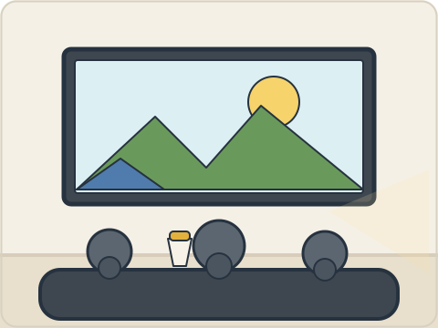

很高兴看电影。 *Hěn gāoxìng kàn diànyǐng.* — **√**

**1.** （　　）

**2.** （　　）

**3.** （　　）

**4.** （　　）

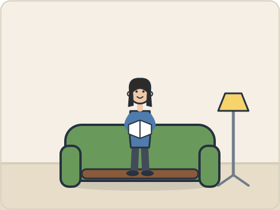

**5.** （　　）

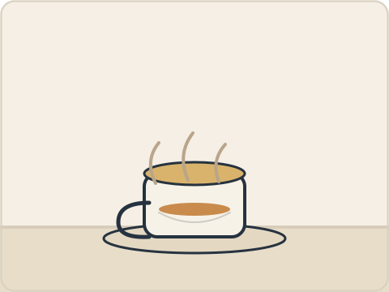

### 第二部分 · Part 2 (6–10)

听录音，选择相应的图片。 *Tīng lùyīn, xuǎnzé xiāngyìng de túpiàn.* Listen and choose the matching picture.

**Example / 例如**  
这是我的书。 *Zhè shì wǒ de shū.*

<table><tr><td align="center" valign="top">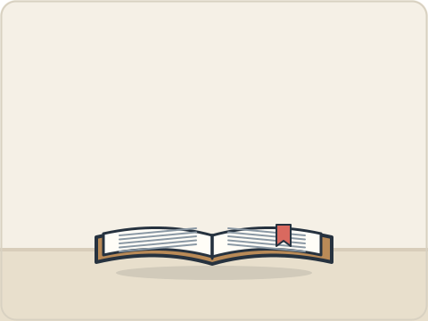 <b>A</b></td><td align="center" valign="top">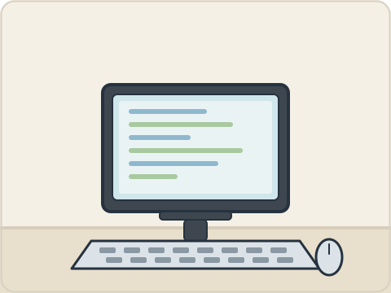 <b>B</b></td><td align="center" valign="top">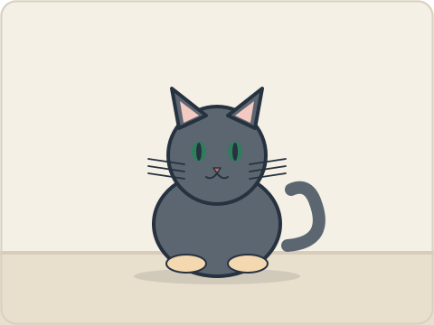 <b>C</b></td></tr></table>

Answer: **A**

**6.** （　　）

<table><tr><td align="center" valign="top">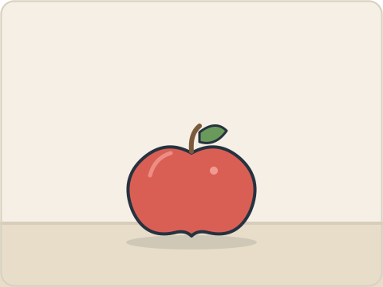 <b>A</b></td><td align="center" valign="top"> <b>B</b></td><td align="center" valign="top">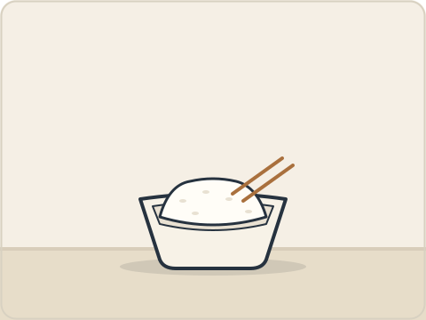 <b>C</b></td></tr></table>

**7.** （　　）

<table><tr><td align="center" valign="top"> <b>A</b></td><td align="center" valign="top">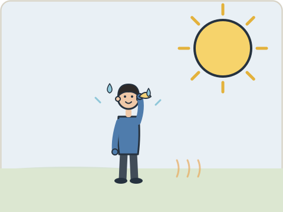 <b>B</b></td><td align="center" valign="top">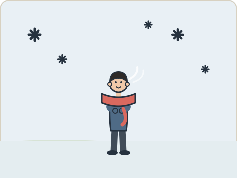 <b>C</b></td></tr></table>

**8.** （　　）

<table><tr><td align="center" valign="top"> <b>A</b></td><td align="center" valign="top">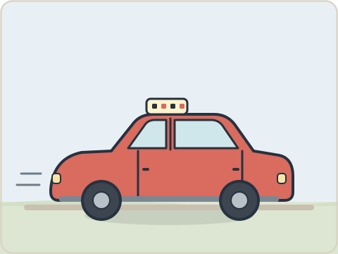 <b>B</b></td><td align="center" valign="top">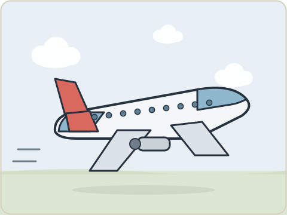 <b>C</b></td></tr></table>

**9.** （　　）

<table><tr><td align="center" valign="top">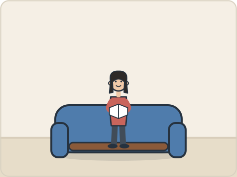 <b>A</b></td><td align="center" valign="top"> <b>B</b></td><td align="center" valign="top">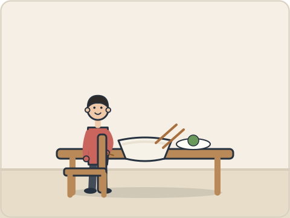 <b>C</b></td></tr></table>

**10.** （　　）

<table><tr><td align="center" valign="top"> <b>A</b></td><td align="center" valign="top">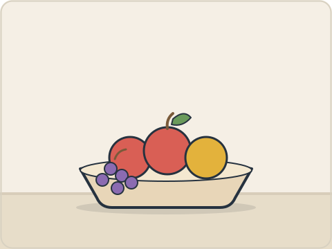 <b>B</b></td><td align="center" valign="top">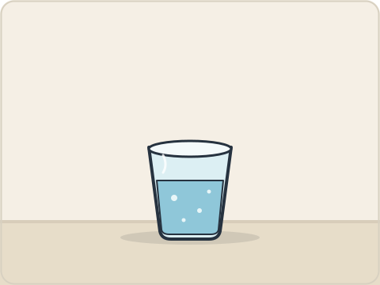 <b>C</b></td></tr></table>

### 第三部分 · Part 3 (11–15)

听录音，选择相应的图片。 *Tīng lùyīn, xuǎnzé xiāngyìng de túpiàn.* Listen to each dialogue and choose its picture. One picture is not used.

**Example / 例如**  
女：你好！ 男：你好！很高兴认识你。  
*Nǚ: Nǐ hǎo! Nán: Nǐ hǎo! Hěn gāoxìng rènshi nǐ.* — **A**

<table><tr><td align="center" valign="top">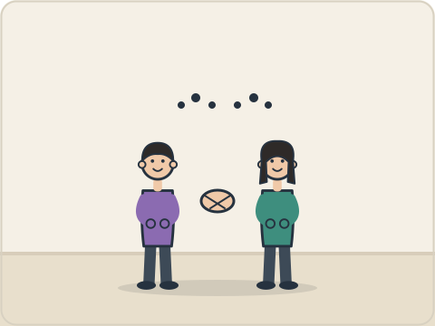 <b>A</b></td><td align="center" valign="top">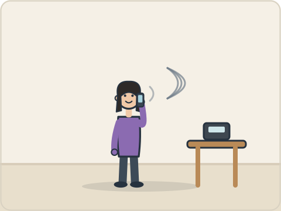 <b>B</b></td><td align="center" valign="top">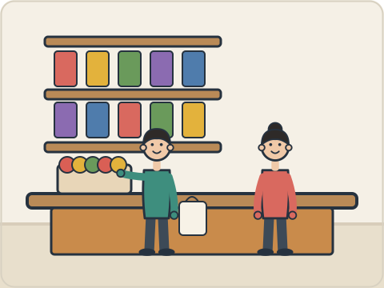 <b>C</b></td></tr><tr><td align="center" valign="top">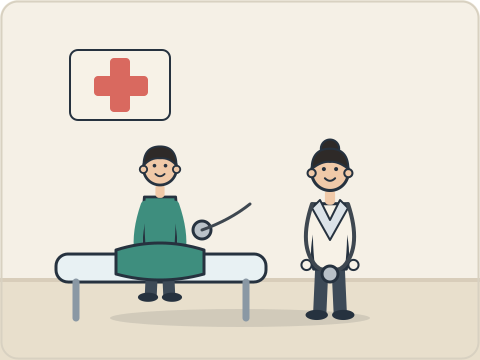 <b>D</b></td><td align="center" valign="top">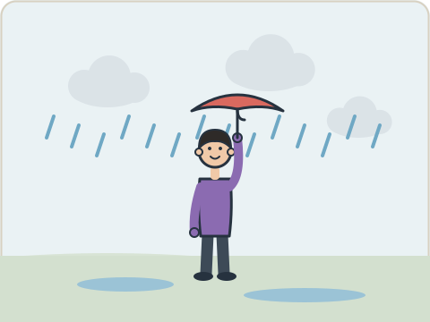 <b>E</b></td><td align="center" valign="top">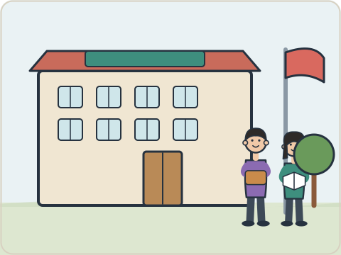 <b>F</b></td></tr></table>

<table><tr><td align="center" valign="top">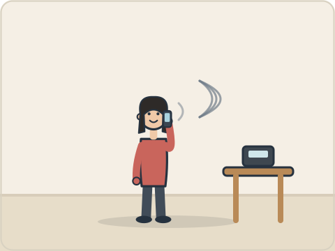 <b>A</b></td><td align="center" valign="top">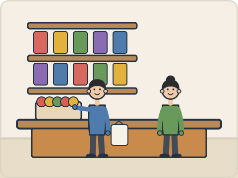 <b>B</b></td><td align="center" valign="top">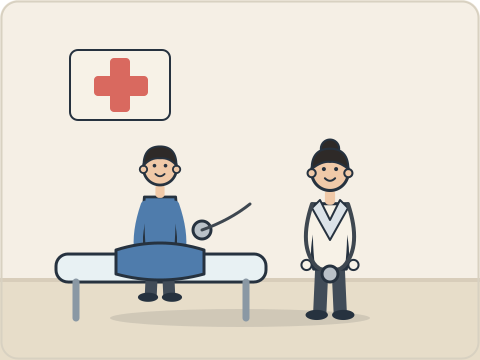 <b>C</b></td></tr><tr><td align="center" valign="top"> <b>D</b></td><td align="center" valign="top">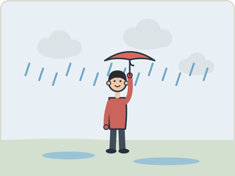 <b>E</b></td><td align="center" valign="top">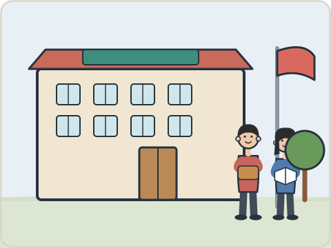 <b>F</b></td></tr></table>

**11.** （　　） | **12.** （　　） | **13.** （　　） | **14.** （　　） | **15.** （　　）

### 第四部分 · Part 4 (16–20)

听录音，选择答案。 *Tīng lùyīn, xuǎnzé dá'àn.* Listen and choose the answer.

**Example / 例如**  
下午我去商店，我想买一些水果。 *Xiàwǔ wǒ qù shāngdiàn, wǒ xiǎng mǎi yìxiē shuǐguǒ.*  
问：她去哪儿？ *Tā qù nǎr?*  
A 商店（*shāngdiàn*）　B 医院（*yīyuàn*）　C 学校（*xuéxiào*） — **A**

**16.** （　　）

**A** 星期一（*xīngqīyī*）　**B** 星期三（*xīngqīsān*）　**C** 星期五（*xīngqīwǔ*）

**17.** （　　）

**A** 坐飞机（*zuò fēijī*）　**B** 坐出租车（*zuò chūzūchē*）　**C** 坐火车（*zuò huǒchē*）

**18.** （　　）

**A** 学校（*xuéxiào*）　**B** 医院（*yīyuàn*）　**C** 商店（*shāngdiàn*）

**19.** （　　）

**A** 四岁（*sì suì*）　**B** 六岁（*liù suì*）　**C** 五岁（*wǔ suì*）

**20.** （　　）

**A** 很热（*hěn rè*）　**B** 下雨（*xià yǔ*）　**C** 很冷（*hěn lěng*）

---

## 二、阅读 · Reading

### 第一部分 · Part 1 (21–25)

看图片和词语，判断对错。 *Kàn túpiàn hé cíyǔ, pànduàn duì cuò.* Look at the picture and the word; mark **√** or **×**.

**Example / 例如**  
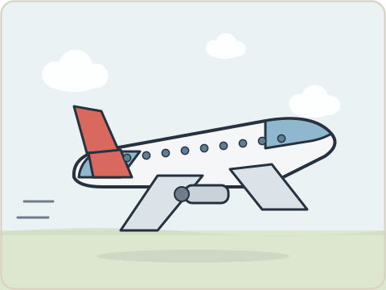

飞机 *fēijī* — **√**

**21.** （　　）

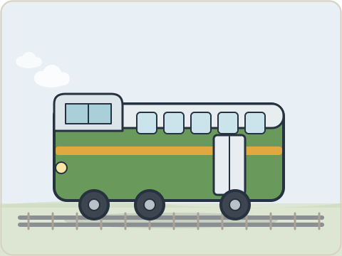

**火车** *huǒchē*

**22.** （　　）

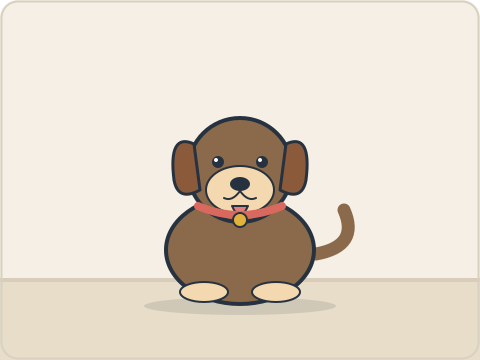

**猫** *māo*

**23.** （　　）

**苹果** *píngguǒ*

**24.** （　　）

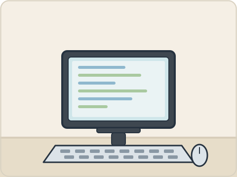

**电视** *diànshì*

**25.** （　　）

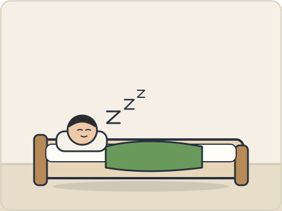

**睡觉** *shuìjiào*

### 第二部分 · Part 2 (26–30)

选择相应的图片。 *Xuǎnzé xiāngyìng de túpiàn.* Choose the matching picture for each sentence. One picture is not used.

**Example / 例如**  
我很喜欢这本书。 *Wǒ hěn xǐhuan zhè běn shū.* — **A**

<table><tr><td align="center" valign="top"> <b>A</b></td><td align="center" valign="top"> <b>B</b></td><td align="center" valign="top"> <b>C</b></td></tr><tr><td align="center" valign="top"> <b>D</b></td><td align="center" valign="top"> <b>E</b></td><td align="center" valign="top"> <b>F</b></td></tr></table>

<table><tr><td align="center" valign="top">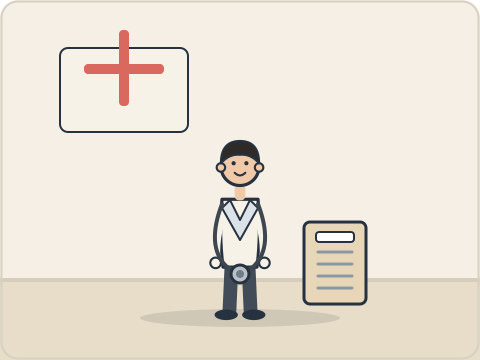 <b>A</b></td><td align="center" valign="top">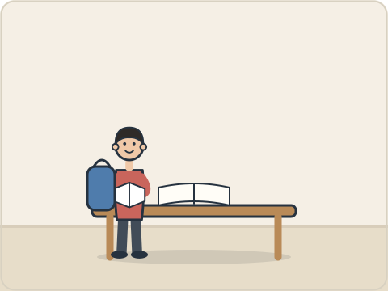 <b>B</b></td><td align="center" valign="top"> <b>C</b></td></tr><tr><td align="center" valign="top">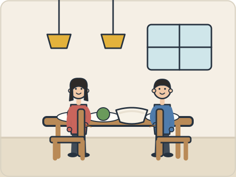 <b>D</b></td><td align="center" valign="top">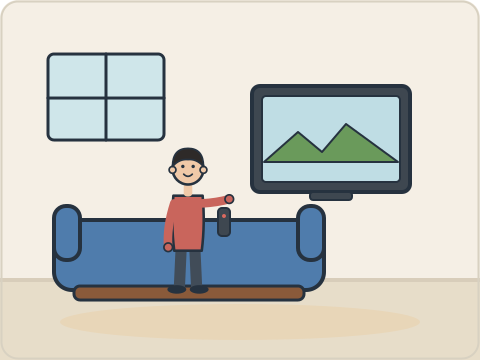 <b>E</b></td><td align="center" valign="top"> <b>F</b></td></tr></table>

**26.** （　　） 他坐出租车去学校。  
*Tā zuò chūzūchē qù xuéxiào.*

**27.** （　　） 她在饭馆吃米饭。  
*Tā zài fànguǎn chī mǐfàn.*

**28.** （　　） 我下午在家看电视。  
*Wǒ xiàwǔ zài jiā kàn diànshì.*

**29.** （　　） 我妈妈是医生，她在医院工作。  
*Wǒ māma shì yīshēng, tā zài yīyuàn gōngzuò.*

**30.** （　　） 昨天下雨了，天气很冷。  
*Zuótiān xià yǔ le, tiānqì hěn lěng.*

### 第三部分 · Part 3 (31–35)

找出对应的回答。 *Zhǎo chū duìyìng de huídá.* Match each question with its answer.

**Example / 例如**  
你喝水吗？ *Nǐ hē shuǐ ma?* — **F** 好的，谢谢！

| | Answer |
| --- | --- |
| **A** | 我八岁。 *Wǒ bā suì.* |
| **B** | 我叫王月。 *Wǒ jiào Wáng Yuè.* |
| **C** | 现在三点。 *Xiànzài sān diǎn.* |
| **D** | 我坐火车去。 *Wǒ zuò huǒchē qù.* |
| **E** | 我喜欢苹果。 *Wǒ xǐhuan píngguǒ.* |
| **F** | 谢谢你。 *Xièxie nǐ.* |

**31.** （　　） 你叫什么名字？  
*Nǐ jiào shénme míngzi?*

**32.** （　　） 现在几点？  
*Xiànzài jǐ diǎn?*

**33.** （　　） 你几岁？  
*Nǐ jǐ suì?*

**34.** （　　） 你喜欢什么水果？  
*Nǐ xǐhuan shénme shuǐguǒ?*

**35.** （　　） 你怎么去北京？  
*Nǐ zěnme qù Běijīng?*

### 第四部分 · Part 4 (36–40)

选词填空。 *Xuǎn cí tián kòng.* Choose the word for each blank. One option is not used.

**Example / 例如**  
A 家　B 火车站　C 对不起　D 名字　E 看见　F 学习  
你叫什么（ **D** ）？ *Nǐ jiào shénme (míngzi)?*

| | Word | | Word |
| --- | --- | --- | --- |
| **A** | 在 *zài* | **B** | 几 *jǐ* |
| **C** | 对不起 *duìbuqǐ* | **D** | 名字 *míngzi* |
| **E** | 看见 *kànjiàn* | **F** | 学习 *xuéxí* |

**36.** 你写（　）吗？  
*Nǐ xiě (　) ma?*

**37.** 你家有（　）个人？  
*Nǐ jiā yǒu (　) gè rén?*

**38.** 我上午（　）学校。  
*Wǒ shàngwǔ (　) xuéxiào.*

**39.** 女：（　），我不能去。 男：没关系。  
*Nǚ: (　), wǒ bù néng qù. Nán: Méi guānxi.*

**40.** 明天我们（　）汉语。  
*Míngtiān wǒmen (　) Hànyǔ.*

---

**End of test.** Transfer your answers to the answer sheet. Do not turn to the answer key until the sitting is finished.
