# HSK 1 Mock 03 — 朋友和家

*Péngyou hé jiā* · **Friends and home**

**Original practice paper — not an official HSK test.**  
Follows the current regular HSK 1 (HSK 2.0) structure used for 2026 test dates: Listening 20 items, Reading 20 items, about 40 minutes including 5 minutes for personal information. All Chinese is printed with pinyin, as in the official HSK 1 paper. No audio file is included; the listening section is read aloud by an examiner. See `ADMINISTRATION.md`.

| Part | Items | Suggested time |
| --- | ---: | ---: |
| Listening 1–4 | 1–20 | about 15 minutes |
| Transfer listening answers | — | 3 minutes |
| Reading 1–4 | 21–40 | 17 minutes |
| **Total** | **40** | **about 35 minutes + 5 minutes personal information** |

---

## 一、听力 · Listening

### 第一部分 · Part 1 (1–5)

听录音，判断对错。 *Tīng lùyīn, pànduàn duì cuò.* Listen and mark **√** or **×**.

**Example / 例如**  
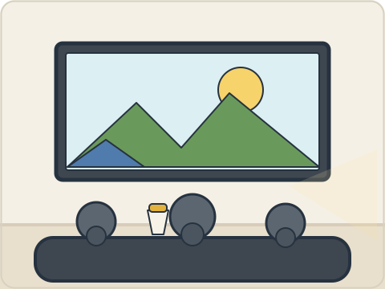

很高兴看电影。 *Hěn gāoxìng kàn diànyǐng.* — **√**

**1.** （　　）

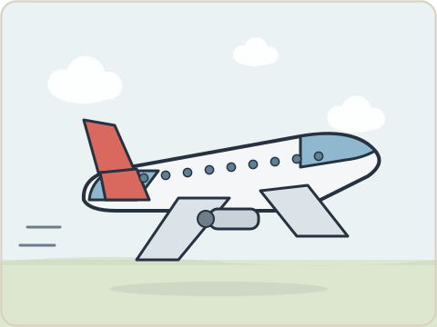

**2.** （　　）

**3.** （　　）

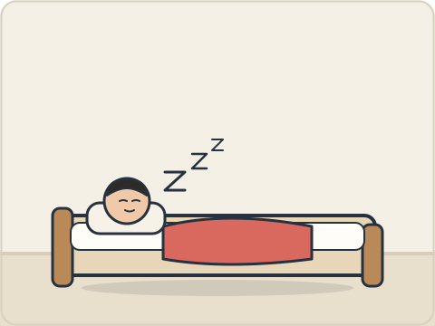

**4.** （　　）

**5.** （　　）

### 第二部分 · Part 2 (6–10)

听录音，选择相应的图片。 *Tīng lùyīn, xuǎnzé xiāngyìng de túpiàn.* Listen and choose the matching picture.

**Example / 例如**  
这是我的书。 *Zhè shì wǒ de shū.*

<table><tr><td align="center" valign="top"> <b>A</b></td><td align="center" valign="top">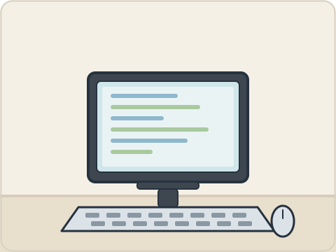 <b>B</b></td><td align="center" valign="top"> <b>C</b></td></tr></table>

Answer: **A**

**6.** （　　）

<table><tr><td align="center" valign="top"> <b>A</b></td><td align="center" valign="top"> <b>B</b></td><td align="center" valign="top"> <b>C</b></td></tr></table>

**7.** （　　）

<table><tr><td align="center" valign="top">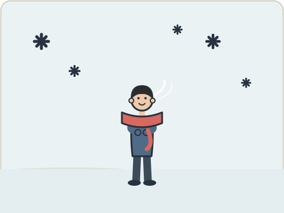 <b>A</b></td><td align="center" valign="top">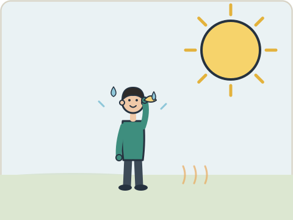 <b>B</b></td><td align="center" valign="top">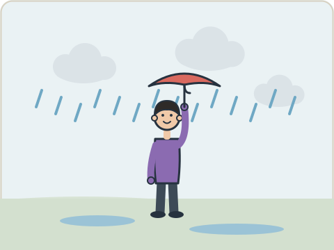 <b>C</b></td></tr></table>

**8.** （　　）

<table><tr><td align="center" valign="top">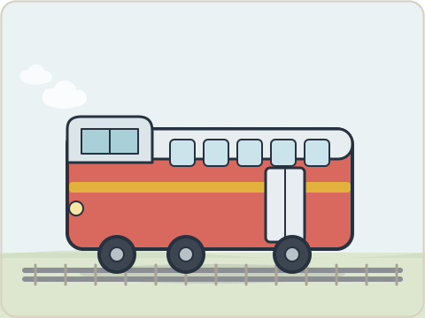 <b>A</b></td><td align="center" valign="top"> <b>B</b></td><td align="center" valign="top"> <b>C</b></td></tr></table>

**9.** （　　）

<table><tr><td align="center" valign="top">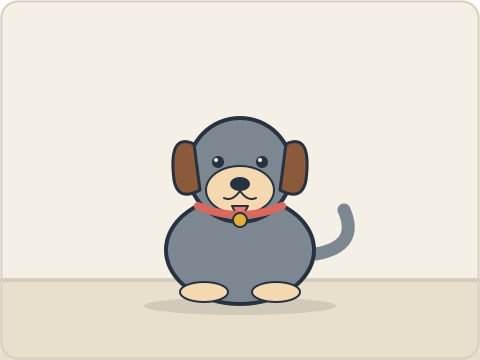 <b>A</b></td><td align="center" valign="top">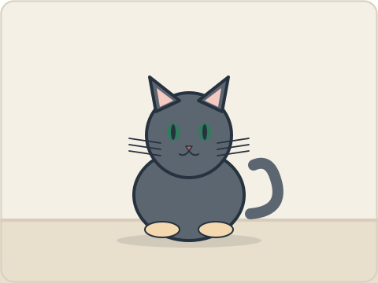 <b>B</b></td><td align="center" valign="top">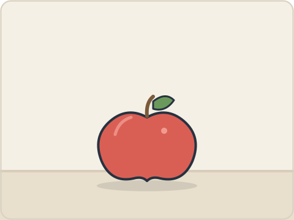 <b>C</b></td></tr></table>

**10.** （　　）

<table><tr><td align="center" valign="top">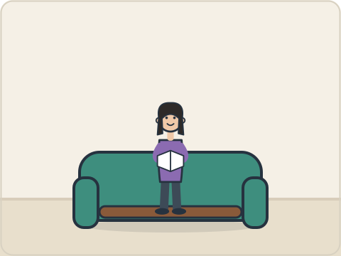 <b>A</b></td><td align="center" valign="top"> <b>B</b></td><td align="center" valign="top">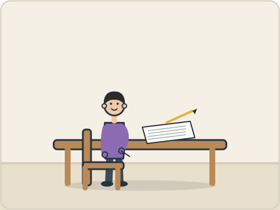 <b>C</b></td></tr></table>

### 第三部分 · Part 3 (11–15)

听录音，选择相应的图片。 *Tīng lùyīn, xuǎnzé xiāngyìng de túpiàn.* Listen to each dialogue and choose its picture. One picture is not used.

**Example / 例如**  
女：你好！ 男：你好！很高兴认识你。  
*Nǚ: Nǐ hǎo! Nán: Nǐ hǎo! Hěn gāoxìng rènshi nǐ.* — **A**

<table><tr><td align="center" valign="top">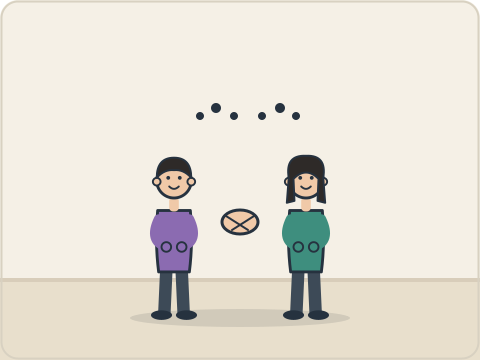 <b>A</b></td><td align="center" valign="top">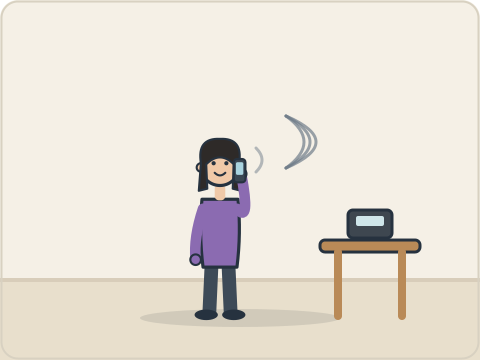 <b>B</b></td><td align="center" valign="top">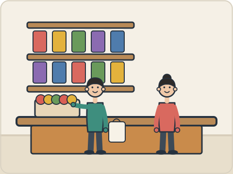 <b>C</b></td></tr><tr><td align="center" valign="top">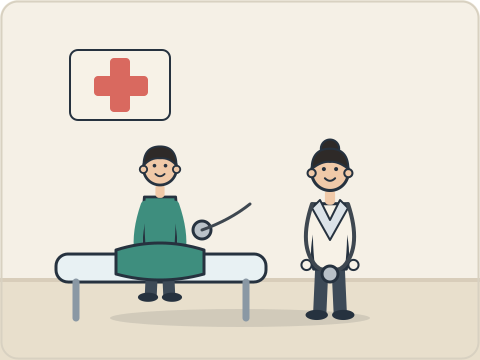 <b>D</b></td><td align="center" valign="top"> <b>E</b></td><td align="center" valign="top"> <b>F</b></td></tr></table>

<table><tr><td align="center" valign="top"> <b>A</b></td><td align="center" valign="top"> <b>B</b></td><td align="center" valign="top">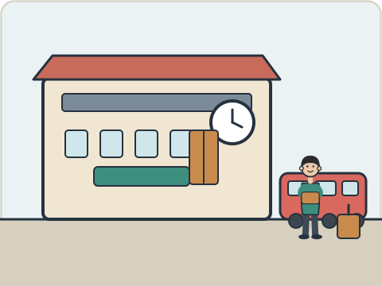 <b>C</b></td></tr><tr><td align="center" valign="top"> <b>D</b></td><td align="center" valign="top">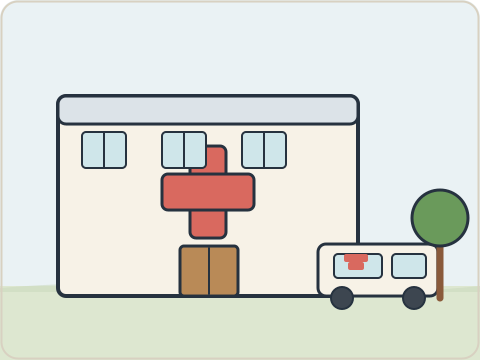 <b>E</b></td><td align="center" valign="top">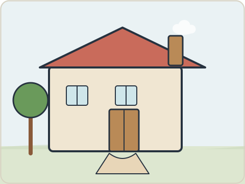 <b>F</b></td></tr></table>

**11.** （　　） | **12.** （　　） | **13.** （　　） | **14.** （　　） | **15.** （　　）

### 第四部分 · Part 4 (16–20)

听录音，选择答案。 *Tīng lùyīn, xuǎnzé dá'àn.* Listen and choose the answer.

**Example / 例如**  
下午我去商店，我想买一些水果。 *Xiàwǔ wǒ qù shāngdiàn, wǒ xiǎng mǎi yìxiē shuǐguǒ.*  
问：她去哪儿？ *Tā qù nǎr?*  
A 商店（*shāngdiàn*）　B 医院（*yīyuàn*）　C 学校（*xuéxiào*） — **A**

**16.** （　　）

**A** 三点（*sān diǎn*）　**B** 四点（*sì diǎn*）　**C** 五点（*wǔ diǎn*）

**17.** （　　）

**A** 坐火车（*zuò huǒchē*）　**B** 坐飞机（*zuò fēijī*）　**C** 坐出租车（*zuò chūzūchē*）

**18.** （　　）

**A** 医院（*yīyuàn*）　**B** 学校（*xuéxiào*）　**C** 商店（*shāngdiàn*）

**19.** （　　）

**A** 五岁（*wǔ suì*）　**B** 七岁（*qī suì*）　**C** 六岁（*liù suì*）

**20.** （　　）

**A** 很热（*hěn rè*）　**B** 很冷（*hěn lěng*）　**C** 下雨（*xià yǔ*）

---

## 二、阅读 · Reading

### 第一部分 · Part 1 (21–25)

看图片和词语，判断对错。 *Kàn túpiàn hé cíyǔ, pànduàn duì cuò.* Look at the picture and the word; mark **√** or **×**.

**Example / 例如**  

飞机 *fēijī* — **√**

**21.** （　　）

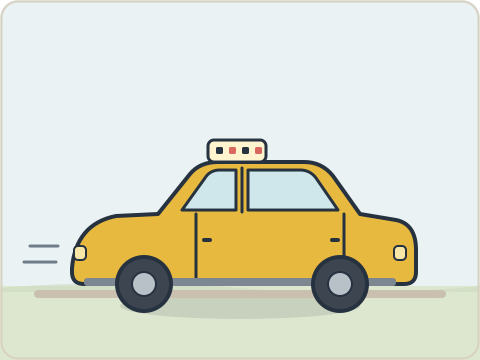

**火车** *huǒchē*

**22.** （　　）

**猫** *māo*

**23.** （　　）

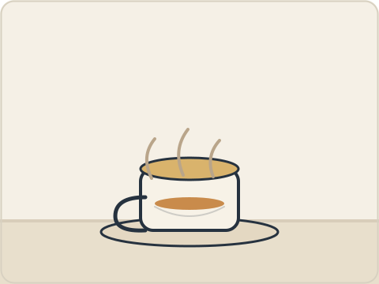

**水** *shuǐ*

**24.** （　　）

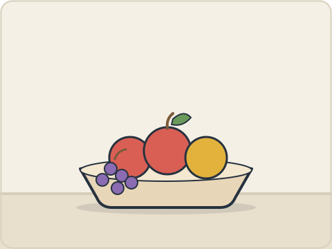

**水果** *shuǐguǒ*

**25.** （　　）

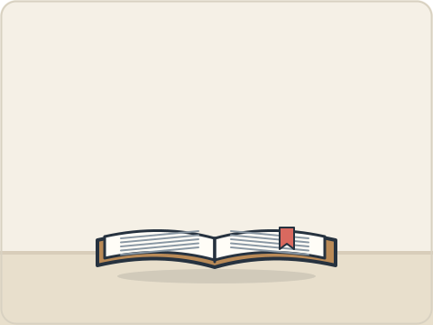

**电视** *diànshì*

### 第二部分 · Part 2 (26–30)

选择相应的图片。 *Xuǎnzé xiāngyìng de túpiàn.* Choose the matching picture for each sentence. One picture is not used.

**Example / 例如**  
我很喜欢这本书。 *Wǒ hěn xǐhuan zhè běn shū.* — **A**

<table><tr><td align="center" valign="top"> <b>A</b></td><td align="center" valign="top"> <b>B</b></td><td align="center" valign="top"> <b>C</b></td></tr><tr><td align="center" valign="top"> <b>D</b></td><td align="center" valign="top"> <b>E</b></td><td align="center" valign="top"> <b>F</b></td></tr></table>

<table><tr><td align="center" valign="top">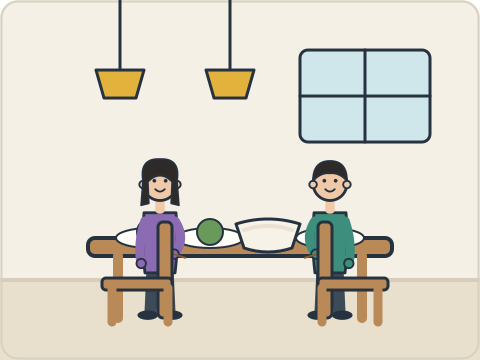 <b>A</b></td><td align="center" valign="top"> <b>B</b></td><td align="center" valign="top"> <b>C</b></td></tr><tr><td align="center" valign="top">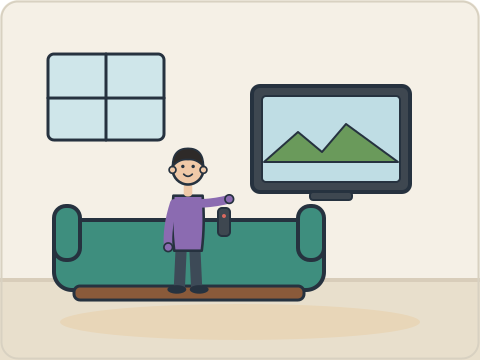 <b>D</b></td><td align="center" valign="top">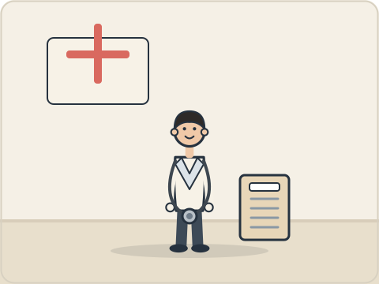 <b>E</b></td><td align="center" valign="top">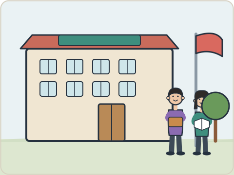 <b>F</b></td></tr></table>

**26.** （　　） 我们中午在饭馆吃米饭。  
*Wǒmen zhōngwǔ zài fànguǎn chī mǐfàn.*

**27.** （　　） 他坐火车去北京。  
*Tā zuò huǒchē qù Běijīng.*

**28.** （　　） 她上午在商店买水果。  
*Tā shàngwǔ zài shāngdiàn mǎi shuǐguǒ.*

**29.** （　　） 她上午在家看电视。  
*Tā shàngwǔ zài jiā kàn diànshì.*

**30.** （　　） 我朋友是医生。  
*Wǒ péngyou shì yīshēng.*

### 第三部分 · Part 3 (31–35)

找出对应的回答。 *Zhǎo chū duìyìng de huídá.* Match each question with its answer.

**Example / 例如**  
你喝水吗？ *Nǐ hē shuǐ ma?* — **F** 好的，谢谢！

| | Answer |
| --- | --- |
| **A** | 我叫李月。 *Wǒ jiào Lǐ Yuè.* |
| **B** | 现在上午九点。 *Xiànzài shàngwǔ jiǔ diǎn.* |
| **C** | 我吃苹果。 *Wǒ chī píngguǒ.* |
| **D** | 我家有四个人。 *Wǒ jiā yǒu sì gè rén.* |
| **E** | 谢谢你。 *Xièxie nǐ.* |
| **F** | 我坐出租车去。 *Wǒ zuò chūzūchē qù.* |

**31.** （　　） 你叫什么？  
*Nǐ jiào shénme?*

**32.** （　　） 你家有几个人？  
*Nǐ jiā yǒu jǐ gè rén?*

**33.** （　　） 现在几点？  
*Xiànzài jǐ diǎn?*

**34.** （　　） 你怎么去学校？  
*Nǐ zěnme qù xuéxiào?*

**35.** （　　） 你吃什么水果？  
*Nǐ chī shénme shuǐguǒ?*

### 第四部分 · Part 4 (36–40)

选词填空。 *Xuǎn cí tián kòng.* Choose the word for each blank. One option is not used.

**Example / 例如**  
A 家　B 火车站　C 对不起　D 名字　E 看见　F 学习  
你叫什么（ **D** ）？ *Nǐ jiào shénme (míngzi)?*

| | Word | | Word |
| --- | --- | --- | --- |
| **A** | 住 *zhù* | **B** | 多少 *duōshao* |
| **C** | 高兴 *gāoxìng* | **D** | 看见 *kànjiàn* |
| **E** | 几 *jǐ* | **F** | 对不起 *duìbuqǐ* |

**36.** 你（　）在哪儿？  
*Nǐ (　) zài nǎr?*

**37.** 这个杯子（　）钱？  
*Zhège bēizi (　) qián?*

**38.** 认识你，我很（　）。  
*Rènshi nǐ, wǒ hěn (　).*

**39.** 女：（　），我不能去学校。 男：没关系。  
*Nǚ: (　), wǒ bù néng qù xuéxiào. Nán: Méi guānxi.*

**40.** 你（　）王老师了吗？  
*Nǐ (　) Wáng lǎoshī le ma?*

---

**End of test.** Transfer your answers to the answer sheet. Do not turn to the answer key until the sitting is finished.
