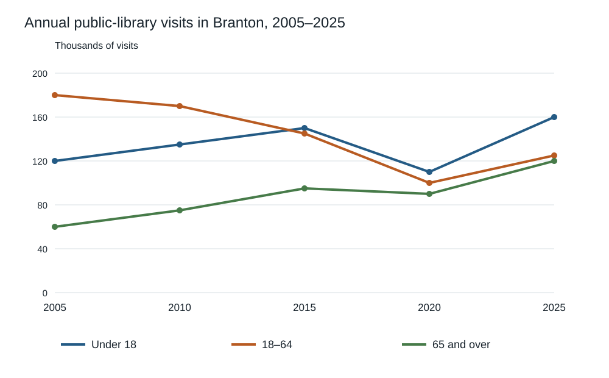

# IELTS Academic — Original Mock 07

Candidate paper • Original independent practice material • Answers and scripts are in separate examiner files.

Use the separate answer sheet. Do not open the examiner script during the test.

## Listening — 40 questions

Listen once. Four parts, ten questions each. Follow the word limits. See [ADMINISTRATION.md](../ADMINISTRATION.md) for the playback or reader-led protocol.

[Play the complete Listening test](audio/listening-full.mp3). Reading and checking pauses are already included. Play continuously without pausing or replaying during a timed sitting.

### Part 1 — Booking a community kitchen

[Part 1 audio](audio/part-1.mp3) — use for separate-part practice.

#### Questions 1–5

Complete the notes. Write ONE WORD AND/OR A NUMBER for each answer.

**1.** Booking contact’s surname: ____

**2.** Chosen day: ____

**3.** Start time: ____

**4.** Total hire charge: £____

**5.** Deposit required: £____

#### Questions 6–10

Complete the notes. Write ONE WORD ONLY for each answer.

**6.** Each participant must bring an ____.

**7.** Wheelchair users should use the ____ entrance.

**8.** Ingredients may be kept in the ____ from midday.

**9.** The organiser should email the ____ by Monday.

**10.** Participants should initially gather outside the ____.

### Part 2 — Welcome to the riverside craft fair

[Part 2 audio](audio/part-2.mp3) — use for separate-part practice.

Plan (not to scale). North / river is at the top. All boxes are beside the straight central path.

```text
                 RIVER / NORTH
       +-------------+   +-------------+
       |      A      |   |      B      |
       +-------------+   +-------------+
                    PATH
       +-------------+   +-------------+
       |      C      |---|      D      |  CROSSING
       +-------------+   +-------------+
                    PATH
       +-------------+   +-------------+
       |      E      |   |      F      |
       +-------------+   +-------------+
                    GATE
```


#### Questions 11–15

Label the plan with the correct location letter. Write the correct letter. You may use any letter more than once.

- **A** Location on the plan
- **B** Location on the plan
- **C** Location on the plan
- **D** Location on the plan
- **E** Location on the plan
- **F** Location on the plan

**11.** Information tent

**12.** Bag store

**13.** Pottery demonstrations

**14.** Repair stall

**15.** Quiet seating

#### Questions 16–20

Choose the correct letter, A, B or C.

**16.** Why is the fair on Saturday?

- **A** Rain was forecast for Sunday.
- **B** The road is needed for another event on Sunday.
- **C** The makers requested a shorter weekend.

**17.** What will evening-music income support?

- **A** New display tables.
- **B** Sound equipment for performers.
- **C** Communication access at the next fair.

**18.** What is required at the children’s workshop?

- **A** An adult must remain with the child.
- **B** A place must be booked beforehand.
- **C** Children must bring their own materials.

**19.** What is the main packaging aim?

- **A** To package all items in recyclable layers.
- **B** To reduce how much packaging is used.
- **C** To prohibit protection of fragile items.

**20.** Why complete the paper form today?

- **A** It is the only way to enter a prize draw.
- **B** No online feedback will be accepted.
- **C** Details of the visit will still be easy to recall.

### Part 3 — Planning a study of queue information

[Part 3 audio](audio/part-3.mp3) — use for separate-part practice.

#### Questions 21–25

Choose the correct letter, A, B or C.

**21.** Why do the students revise their initial project?

- **A** It attempted to examine too many things.
- **B** The manager refused all observation.
- **C** No queues existed at the café.

**22.** How will actual waiting time be measured?

- **A** By customers recalling it later.
- **B** By reading the estimated-wait sign.
- **C** By recording arrival and service times.

**23.** Why choose Tuesday and Thursday lunch periods?

- **A** They attract exactly the same customers.
- **B** Some important operating conditions are similar.
- **C** No unusual events can occur on those days.

**24.** Why alternate the order of time blocks?

- **A** To avoid consistently showing the sign later.
- **B** To make the café serve everyone faster.
- **C** To let each customer choose a condition.

**25.** When will people be invited to answer questions?

- **A** As they enter the café.
- **B** While they choose their food.
- **C** After they have been served.

#### Questions 26–30

What action do the students decide on for each item? Write the correct letter. You may use any letter more than once.

- **A** Try it out before the main study
- **B** Obtain tutor approval
- **C** Remove it
- **D** Treat it as completed
- **E** Decide after collecting data
- **F** Ask customers to design it

**26.** Consent notice

**27.** Manager’s permission

**28.** Timing sheet

**29.** Spending question

**30.** Final chart format

### Part 4 — How wetlands preserve traces of the past

[Part 4 audio](audio/part-4.mp3) — use for separate-part practice.

#### Questions 31–40

Complete the notes. Write ONE WORD ONLY for each answer.

**31.** Preservation can occur when water restricts the supply of ____.

**32.** The position of objects within ____ helps establish relationships between events.

**33.** An object separated from its ____ answers fewer questions.

**34.** The tiny plant particles discussed as evidence of earlier vegetation are ____.

**35.** Tiny samples may be studied using a ____.

**36.** Researchers must guard against ____ by newer material.

**37.** A major threat to preservation is ____.

**38.** Conservators should plan ____ before objects are excavated.

**39.** Leaving deposits in place may require continuing ____.

**40.** Visitors should distinguish a ____ from original material.

## Reading — 60 minutes, 40 questions

Spend about 20 minutes on each passage. All answers must be on the answer sheet within the 60 minutes; there is no extra transfer time.

### Passage 1 — The second life of a railway station

**A** When the last passenger train left Mereford's station, the council inherited a building that seemed inconvenient in almost every respect. Its long waiting room was costly to heat, the platform divided the site, and there was little parking. Several councillors favoured demolition. Residents, however, remembered the station as the town's informal meeting place, not merely somewhere to board a train. A public consultation therefore asked what activities the town lacked before asking what should happen to the building. This reversed the usual sequence of choosing a use and then seeking support for it.

**B** The consultation revealed demand for spaces that could be borrowed briefly: a room for a job interview, a table for a small club, or somewhere to mend a torn coat. It did not reveal much enthusiasm for another exhibition about railway history. The architects initially proposed one large open hall, believing that maximum flexibility required minimum division. During a trial weekend, however, a children's storytelling session overwhelmed a conversation group at the opposite end. Curtains softened the appearance but did little to stop sound. The final plan included several enclosed rooms with glazed doors, retaining visual openness while allowing incompatible activities to coexist.

**C** Keeping the platform was another disputed decision. It could not provide step-free access by itself, and early sketches treated it as an obstacle to be removed. A resident who used a wheelchair suggested a gently sloping route along the outer wall instead. The resulting ramp joined the old platform at its far end and created a sheltered place to wait. It was longer than a direct staircase but required no lift or electrical machinery. The design team subsequently used this route as the principal entrance for everyone, rather than labelling it as a separate accessible entrance.

**D** Finances shaped the refurbishment as much as architectural preference. The project had received a grant for construction but no permanent promise to cover running costs. The committee rejected polished stone flooring because its price would consume money needed for insulation. Original floorboards were repaired where possible; damaged sections were replaced with matching reclaimed timber. The choices were not presented as historical reconstruction. The committee wanted a building that could survive everyday wear and remain affordable to maintain, even when the initial excitement had faded and volunteers had other demands on their time.

**E** The first winter tested those priorities. A new booking system showed that most daytime users needed only two of the rooms. Heating the entire building for them made little sense, so separate heating controls were installed. Users could reserve adjoining rooms when they needed more space. Electricity use fell, although the committee warned that the mild winter prevented a fair comparison with the station's previous bills. It published monthly meter readings alongside opening hours, allowing residents to see both the expenditure and the amount of activity it supported. No claim of a precise percentage saving was made.

**F** Running the centre also required rules that were less visible than the renovation. Small groups could book ordinary meetings without charge, while commercial courses paid a modest fee. A refundable deposit covered the keys, but the committee offered an alternative arrangement for residents who could not afford it. Volunteers discovered that a complicated application form discouraged the very informal groups the centre hoped to attract. They replaced it with a short conversation and a one-page agreement. Insurance and safety requirements remained, but the process no longer assumed that every group had an experienced secretary.

**G** After two years, attendance alone was no longer considered a sufficient measure of success. A crowded craft market might attract many people who never returned, while a weekly reading group could matter greatly to six regular participants. The coordinator began keeping a diary of requests that the centre could not accommodate. Some concerned opening hours, others the lack of storage or difficulty reaching the station after the evening bus stopped. This record described unmet needs rather than only celebrating completed bookings. It also helped distinguish problems within the committee's control from those requiring transport or other public services.

**H** Mereford's experience offers no simple formula for every disused station. The building benefited from committed residents and a central location, advantages that cannot be manufactured by a clever floor plan. Nevertheless, its history challenges the idea that preserving a public building means preserving its former purpose. Railway objects occupy one small cabinet, while most rooms serve activities never imagined by the original builders. The committee argues that continued usefulness is a stronger defence against neglect than admiration alone. For this station, keeping the building has depended on allowing its social meaning to change.

#### Questions 1–6

Do these statements agree with the information in the passage? Write TRUE, FALSE or NOT GIVEN.

**1.** The consultation began by identifying activities missing from the town.

**2.** The open-hall arrangement successfully separated noisy and quiet activities.

**3.** The resident who proposed the ramp had previously worked as an architect.

**4.** The ramp became the main entrance for all visitors.

**5.** The construction grant guaranteed future operating funds.

**6.** The reclaimed timber was donated by a local business.

#### Questions 7–13

Complete the notes. Write ONE WORD ONLY for each answer.

**7.** Money was retained for ____ instead of expensive stone floors.

**8.** Each room could be heated separately using its own ____.

**9.** The committee published monthly ____ readings.

**10.** A refundable ____ was normally required for the keys.

**11.** The coordinator recorded unmet requests in a ____.

**12.** One difficulty outside the committee's direct control involved public ____.

**13.** Railway objects are displayed in a small ____.

### Passage 2 — Listening to a landscape

**A** A landscape can be surveyed with a camera, but photographs omit much of what happens beyond the visible frame. A recorder left beside a pond may capture insects, traffic, wind and human voices throughout the night. Researchers use the term soundscape for this combined acoustic environment. It is tempting to describe a rich recording as evidence of a healthy ecosystem. Yet an impressive chorus is not a census. A single loud animal can dominate a microphone, while numerous quiet species remain inaudible. The attraction of sound recording lies partly in its reach, but its limitations begin with the same property.

**B** In an imagined monitoring project at Bellwater Reserve, ecologist Mara Sen placed identical recorders at twelve ponds. Her colleague, technician Owen Price, suggested positioning them where volunteers could reach them easily. Sen objected that convenient paths might also be the noisiest places. They eventually selected positions using a grid, then documented exceptions where water or private land prevented installation. Each microphone was mounted at the same height. This did not eliminate all environmental differences, but it made the reasons for variation more visible. A comparable procedure mattered more than locating the most spectacular sounds.

**C** The team soon encountered a less obvious problem: rain striking protective covers sounded remarkably like repeated animal calls to an automatic detector. Price redesigned the cover and added a short record of weather conditions to every file. Simply deleting all wet nights would have introduced a different bias, because some animals are especially active after rainfall. Instead, the team labelled intervals in which rain interfered with identification. A recording could therefore remain in the archive without being treated as reliable evidence for every possible question. Quality was attached to particular uses, not to the file as a whole.

**D** For comparison with the machine, volunteers listened to short extracts and marked calls they recognised. Training began with clear examples, but Sen insisted on including ambiguous ones before volunteers worked independently. She wanted listeners to recognise uncertainty, not merely memorise ideal calls. Each extract was assessed by two people who could not see one another's decisions. Disagreements were retained for review rather than resolved by automatically choosing the more confident listener. Confidence, Sen noted, was itself a human judgement; it could reflect familiarity with a training example rather than a genuinely distinctive sound.

**E** Software made it possible to search months of recordings quickly. However, detector developer Lila Tran warned against comparing a new system only with its own earlier version. If both versions missed the same quiet species, an apparent improvement could still leave a major gap. Her team built a separate reference set, including recordings from sites absent from the training collection. Performance fell on these unfamiliar sites. Tran regarded this as useful information about the limits of transfer, although a sponsor had hoped to advertise a single accuracy figure. A lower, properly qualified result could guide deployment more effectively than an impressive average.

**F** Interpreting changes over time required another distinction. A decline in detected calls might mean fewer animals, but it could also mean that traffic had increased, masking the same population. Sen therefore paired acoustic observations with occasional visual surveys. These surveys were expensive and covered shorter periods, yet they offered a different kind of evidence. When the two sources disagreed, the team investigated rather than discarding the inconvenient result. No instrument acted as a final judge. The purpose of combining methods was to expose their different blind spots, not to declare that agreement was guaranteed.

**G** The recordings also contained conversations from a footpath near two ponds. Local adviser Imani Cole argued that obtaining permission to place a recorder was not the same as obtaining permission to distribute everything it captured. The public archive consequently excluded speech-containing segments, while authorised researchers could request restricted access for an approved purpose. This reduced the amount of openly available material. Cole considered the restriction a condition of responsible monitoring rather than a failure of scientific openness. Signs near the path explained what was collected and whom residents could contact, including people who never used the project's website.

**H** Soundscape research thus involves more than replacing field visits with unattended devices. Decisions about placement, weather, training and access shape the evidence long before anyone draws an ecological conclusion. Bellwater's fictional project illustrates why cheap data collection need not produce cheap interpretation. The recorder can work while a researcher sleeps, but it cannot decide which uncertainty matters or whose privacy deserves attention. For Sen, the most valuable outcome was not a claim that every pond had been understood. It was a record detailed enough for later researchers to ask different questions without mistaking the original team's choices for facts about nature.

#### Questions 14–17

Which paragraph contains the following information? Write the correct letter. You may use any letter more than once.

- **A** Paragraph
- **B** Paragraph
- **C** Paragraph
- **D** Paragraph
- **E** Paragraph
- **F** Paragraph
- **G** Paragraph
- **H** Paragraph

**14.** a reason for retaining apparently poor-quality material

**15.** a proposed placement method rejected because of possible bias

**16.** an example of two methods producing different results

**17.** a distinction between permission to collect and permission to share

#### Questions 18–21

Match each statement with the correct person. Write the correct letter. You may use any letter more than once.

- **A** Mara Sen
- **B** Owen Price
- **C** Lila Tran
- **D** Imani Cole

**18.** Insisted that training should include uncertain examples

**19.** Altered equipment to reduce a misleading signal

**20.** Asked for testing on material from unfamiliar locations

**21.** Defended limits on the open publication of recordings

#### Questions 22–26

Choose the correct letter, A, B, C or D.

**22.** What does the opening paragraph emphasise?

- **A** Recorders usually miss events outside the camera frame.
- **B** The apparent richness of a recording can be misleading.
- **C** Quiet species are best identified from photographs.
- **D** A single microphone provides a complete species list.

**23.** Why were volunteer disagreements retained?

- **A** The volunteers were not allowed to repeat training.
- **B** The team wanted identical totals from every listener.
- **C** Machines had already resolved all difficult cases.
- **D** Confidence did not necessarily establish correctness.

**24.** How did Tran respond to the lower test result?

- **A** She saw it as helpful for deciding where the system could work.
- **B** She concluded that training sites should replace test sites.
- **C** She treated it as proof that all detectors were useless.
- **D** She proposed reporting only the best-performing site.

**25.** What is the main purpose of the final paragraph?

- **A** To recommend unrestricted access to all field recordings.
- **B** To argue that unattended recording saves no fieldwork.
- **C** To show why recording requires continuing human judgement.
- **D** To establish that ecological conclusions are always impossible.

**26.** What benefit did detailed documentation offer?

- **A** It removed the need for later field observations.
- **B** It supported later questions while revealing original decisions.
- **C** It ensured that all later users would reach one conclusion.
- **D** It made the recordings representative of every landscape.

### Passage 3 — The value of leaving room to choose

**A** The promise of a recommendation system is that it will make an excessive range of choices manageable. A reader opens a catalogue and receives a short list rather than confronting thousands of titles. At its best, such help makes unfamiliar material accessible. Yet a catalogue is also an environment in which preferences develop. A system that repeatedly supplies what someone already appears to like can quietly decide which alternatives the person ever encounters. The central question is therefore not whether recommendations are accurate, but what kind of opportunity that accuracy creates or removes.

**B** One account of good recommendation treats a successful click as evidence that a person's desire has been satisfied. This is reasonable for a narrow request: someone looking for a particular manual benefits from finding it quickly. But a click on an unexpected article may mean curiosity, irritation or accidental selection. Even a long reading time is ambiguous when the text is unusually difficult. Behavioural traces are useful evidence, not transparent windows into intention. A designer who calls every measurable response a revealed preference risks turning the convenience of measurement into a theory of human motivation.

**C** Consider a fictional community library that experiments with two digital shelves. The first orders books by predicted borrowing probability. The second includes a small space for titles selected to differ from the reader's recent loans. During the trial, the second shelf produces fewer immediate reservations but more reports of discovering an unfamiliar author. Neither result alone settles which shelf is better. A reservation and a discovery describe different benefits, and discovery itself may take weeks to become a borrowing decision. Judging the trial by the fastest observable response would build the desired conclusion into the measurement.

**D** Advocates of prediction sometimes reply that users can simply leave the recommended shelf. Formally, the rest of the catalogue is available. Practically, the cost of reaching it matters. A link hidden below several screens is a weaker invitation than a prominent search box. This does not mean every arrangement is manipulation; all interfaces distribute attention in some way. It means that an assessment of freedom must consider effort as well as formal availability. A choice can remain technically possible while becoming unlikely enough to disappear from most people's ordinary experience.

**E** There is an opposing danger in praising surprise without qualification. A system that inserts unfamiliar items arbitrarily may waste time and undermine trust. The relevant distinction is between useful exploration and mere randomness. Someone learning a language might welcome material slightly beyond their current interests, provided its difficulty remains manageable. The same person may not welcome an unrelated technical document presented as an exciting discovery. Good exploration needs a relationship to the user's purpose, even when it challenges a narrow prediction of their taste. Difference is a means to an opportunity, not an achievement by itself.

**F** Giving users control can help, but control must be intelligible. A panel containing many unexplained settings transfers work without necessarily transferring power. More useful controls might let a reader request greater variety, inspect why an item appeared, or temporarily ignore earlier borrowing history. Explanations need not expose every mathematical operation. They should reveal the practical basis of a suggestion well enough for a person to dispute it. If a system infers an interest from a book borrowed for somebody else, the user needs a simple way to correct the inference rather than a technical lecture about the model.

**G** Institutions also need to decide what they will refuse to optimise. A public library may legitimately value access to minority-language material even when predicted demand is low. That choice is not a defect in prediction; it is a statement about the institution's purpose. Leaving such decisions entirely to a model hides a public judgement behind an apparently neutral calculation. Conversely, declaring values does not excuse a badly functioning search service. Institutions need evidence that their systems work and an explicit account of what working means. Technical performance and public responsibility answer different questions, but neither can replace the other.

**H** The best recommendation systems may therefore be those that know when to recede. They can help with a defined search, offer a defensible suggestion and then leave a visible route beyond it. This is not a demand that every user spend more time choosing. For some tasks, fewer decisions are a real benefit. It is a demand that efficiency remain answerable to the person's changing purposes. A successful system should reduce unnecessary effort without treating yesterday's pattern as tomorrow's boundary. The aim is assistance that preserves the possibility of becoming interested in something the model did not anticipate.

#### Questions 27–31

Choose the correct heading for each paragraph from the list below. Write the Roman numeral. Use each heading at most once.

- **i** When novelty needs a purpose
- **ii** Competing measures of a successful trial
- **iii** The disappearance of public libraries
- **iv** Making user control meaningful
- **v** The limits of interpreting behaviour
- **vi** A mathematical solution to every preference
- **vii** Why available choices may be hard to reach

**27.** Paragraph B

**28.** Paragraph C

**29.** Paragraph D

**30.** Paragraph E

**31.** Paragraph F

#### Questions 32–36

Do these statements agree with the views of the writer? Write YES, NO or NOT GIVEN.

**32.** A recommendation should be judged solely by its prediction accuracy.

**33.** Long reading time always demonstrates strong interest.

**34.** Most library users prefer unexpected suggestions to familiar ones.

**35.** An institution can reasonably support material with low predicted demand.

**36.** A system should allow for changes in a user's purposes.

#### Questions 37–40

Complete the notes. Write ONE WORD ONLY for each answer.

**37.** A language learner may benefit from unfamiliar material if its ____ is manageable.

**38.** A user should be able to correct an inaccurate ____ about an interest.

**39.** Choosing to support low-demand material expresses an institution's ____.

**40.** The writer wants a system to reduce unnecessary ____ while preserving exploration.

## Writing — 60 minutes

Complete both tasks in connected prose. Suggested time: Task 1, 20 minutes (at least 150 words); Task 2, 40 minutes (at least 250 words). Task 2 has twice the weight in IELTS assessment.

### Task 1

The line graph shows annual visits to public libraries by three age groups in the fictional city of Branton between 2005 and 2025. Summarise the information by selecting and reporting the main features, and make comparisons where relevant. Write at least 150 words.



Data (thousands of visits; each visit counted, not unique visitors):

| Year | Under 18 | 18–64 | 65 and over |
| --- | ---: | ---: | ---: |
| 2005 | 120 | 180 | 60 |
| 2010 | 135 | 170 | 75 |
| 2015 | 150 | 145 | 95 |
| 2020 | 110 | 100 | 90 |
| 2025 | 160 | 125 | 120 |

### Task 2

Some people think publicly funded scientific research should focus on problems that can be solved soon. Others believe research with uncertain long-term benefits is equally important. Discuss both views and give your own opinion. Give reasons and relevant examples. Write at least 250 words.

## Speaking — 11–14 minutes

The examiner keeps the question list. In Part 2 you receive the cue card below, one minute to prepare and up to two minutes to speak. Parts 1 and 3 are an interview.

### Part 2 cue card

Describe a time when somebody gave you useful advice.

You should say:

- who gave you the advice

- what the situation was

- what you did after receiving it

and explain why the advice was useful to you.
