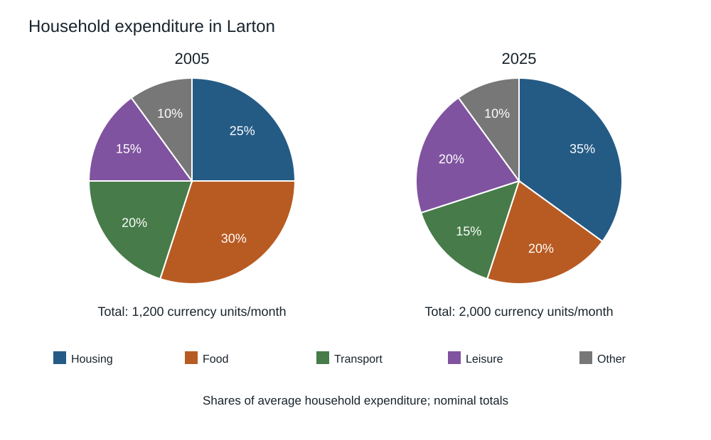

# IELTS Academic — Original Mock 08

Candidate paper • Original independent practice material • Answers and scripts are in separate examiner files.

Use the separate answer sheet. Do not open the examiner script during the test.

## Listening — 40 questions

Listen once. Four parts, ten questions each. Follow the word limits. See [ADMINISTRATION.md](../ADMINISTRATION.md) for the playback or reader-led protocol.

[Play the complete Listening test](audio/listening-full.mp3). Reading and checking pauses are already included. Play continuously without pausing or replaying during a timed sitting.

### Part 1 — Joining a neighbourhood walking group

[Part 1 audio](audio/part-1.mp3) — use for separate-part practice.

#### Questions 1–5

Complete the notes. Write ONE WORD AND/OR A NUMBER for each answer.

**1.** Caller’s surname: ____

**2.** Day of first walk: ____

**3.** Meeting building: ____

**4.** Time to arrive: ____

**5.** Full route length: ____ kilometres

#### Questions 6–10

Complete the notes. Write ONE WORD ONLY for each answer.

**6.** Bring a ____ rather than an umbrella.

**7.** Carry water in a ____.

**8.** The route uses a ____ instead of a stile.

**9.** Animals not permitted on this route: ____

**10.** Cancellation will be announced by ____.

### Part 2 — An orientation talk at a community arts centre

[Part 2 audio](audio/part-2.mp3) — use for separate-part practice.

#### Questions 11–15

What special arrangement applies to each activity? Write the correct letter. You may use any letter more than once.

- **A** Bring a personal item to use
- **B** An adult must join a child
- **C** Reserve a place before attending
- **D** Have previous experience
- **E** Note the revised starting time
- **F** Go to a different venue

**11.** Bookbinding

**12.** Lunchtime sketch group

**13.** Textile printing

**14.** Percussion

**15.** Clay modelling

#### Questions 16–20

Choose the correct letter, A, B or C.

**16.** Why are materials charged separately?

- **A** All courses use identical materials.
- **B** The previous fee shared costs unevenly between activities.
- **C** Membership no longer covers studio maintenance.

**17.** What is the policy on displaying students' work?

- **A** Students can choose not to display it.
- **B** Every first attempt must be exhibited.
- **C** Only advanced students can refuse.

**18.** Why must unfinished work be labelled?

- **A** To rank it by artistic quality.
- **B** To advertise it for sale.
- **C** To manage storage and identify its owner.

**19.** What is said about the café?

- **A** Its purchases are included in membership.
- **B** It operates separately from the centre.
- **C** Tutors take orders during lessons.

**20.** When should a new access difficulty be raised?

- **A** Only at the start of the next term.
- **B** Only before a booking is confirmed.
- **C** When it becomes apparent, including during class.

### Part 3 — Reviewing an interview project

[Part 3 audio](audio/part-3.mp3) — use for separate-part practice.

#### Questions 21–25

Choose the correct letter, A, B or C.

**21.** What is the tutor’s concern about the website list?

- **A** Its street addresses are all out of date.
- **B** It contains too many unrelated districts.
- **C** It omits non-members and former businesses.

**22.** Why should the chair not sit in interviews?

- **A** She has no knowledge of local businesses.
- **B** Her presence might discourage critical responses.
- **C** She has already interviewed every trader.

**23.** What is wrong with the original opening question?

- **A** It presupposes a positive effect.
- **B** It is too technical to understand.
- **C** It requests a precise sales total.

**24.** How should business records be treated?

- **A** Every participant must hand over private accounts.
- **B** Recollections should be discarded if records exist.
- **C** Their availability can be explored without requiring disclosure.

**25.** What does the tutor emphasise about recording?

- **A** All recordings must be publicly accessible.
- **B** Consent to an interview does not automatically allow publication.
- **C** Note-only interviews are unacceptable.

#### Questions 26–30

What next step is agreed for each item? Write the correct letter. You may use any letter more than once.

- **A** Pilot it with someone outside the sample
- **B** Delete it
- **C** Decide after initial data collection
- **D** Get tutor approval
- **E** Consider it complete
- **F** Publish it immediately

**26.** Recruitment invitation

**27.** Interview schedule

**28.** Street map

**29.** Exact-income question

**30.** Final coding categories

### Part 4 — The changing idea of a standard measure

[Part 4 audio](audio/part-4.mp3) — use for separate-part practice.

#### Questions 31–40

Complete the notes. Write ONE WORD ONLY for each answer.

**31.** Different measurement tasks require different degrees of ____.

**32.** A public reference represented both length and ____.

**33.** Wear and ____ could affect copied measures.

**34.** Conversion between local systems could require ____.

**35.** The process of comparison with a reference is ____.

**36.** An error may be managed by applying a ____.

**37.** A material’s size can change with ____.

**38.** Records establish a chain that can be checked through ____.

**39.** Incompatibility between components may only appear at ____.

**40.** Institutions teach measurement procedures through ____.

## Reading — 60 minutes, 40 questions

Spend about 20 minutes on each passage. All answers must be on the answer sheet within the 60 minutes; there is no extra transfer time.

### Passage 1 — A city learns to deliver differently

**A** Every morning, delivery vans entered the narrow streets around Halden Market carrying goods for small independent shops. Many left almost empty after visiting a single customer. Shopkeepers complained about congestion but resisted a proposal to keep vehicles outside the centre: they depended on reliable deliveries and feared another administrative burden. The eventual experiment began with a practical offer rather than a restriction. A warehouse near the ring road would receive consignments from different suppliers, combine them, and complete the final journey with electric cargo cycles. Participation was voluntary during the first six months.

**B** The project manager, Rosa Vale, expected the strongest interest to come from shops selling light, expensive products. In fact, a bakery became one of the earliest regular users. Its flour sacks were too heavy for an ordinary bicycle, but the project's three-wheeled cycles had enclosed load compartments and were designed for commercial loads. The bakery valued predictable arrival times more than the environmental message. Its owner could schedule preparation without leaving a worker watching the street. This response changed the project's publicity, which began emphasising reliability alongside reduced traffic rather than assuming that every business shared the same motivation.

**C** Not every product was suitable. A florist found that delicate arrangements moved during sharp turns unless special supports were fitted. A furniture shop continued receiving large tables directly by lorry, though smaller fittings travelled through the warehouse. These exceptions were recorded instead of being treated as embarrassing failures. The manager wanted a service that removed appropriate journeys, not a claim that one vehicle could replace every other vehicle. Staff kept dimensions and handling instructions with each booking so that an unsuitable consignment could be redirected before it reached the loading bay and delayed other customers.

**D** The warehouse initially asked shops to make orders by midday for next-morning delivery. This suited some businesses but not restaurants that adjusted purchases after the evening service. A later collection from suppliers was introduced on three nights each week. It increased staffing costs, yet also attracted enough regular users to make better use of the morning cycles. The project did not publish a standard saving per delivery, because costs depended on distance, load and how consistently a shop used the service. Monthly statements instead separated the handling charge from the charge for the final journey.

**E** Routes were planned with local knowledge as well as software. The shortest line on a map could involve steep cobbles, steps or a market entrance closed during trading hours. Riders marked these problems on a shared map, and the route planner updated permitted approaches. The city also installed secure loading stands near several shops. Without these, a rider might have to leave a loaded cycle while carrying goods around a corner. Reducing that risk mattered for insurance and for the willingness of riders to accept the work, not simply for the speed of individual deliveries.

**F** Evaluating the trial proved more difficult than counting cycles leaving the warehouse. Some suppliers had previously combined deliveries to several shops on a single van trip. Replacing one shop's parcel did not necessarily remove that trip. The evaluation therefore asked suppliers about routes, not just the number of consignments transferred. It also counted travel between suppliers and the warehouse. These additional movements reduced the estimated traffic benefit but made the comparison more credible. The researchers warned that figures from the first months reflected volunteers who were particularly willing to cooperate and might not represent later customers.

**G** Residents noticed another change that was absent from the original spreadsheet. With fewer vehicles blocking shop fronts at breakfast time, the pavement became easier to use, especially for people pushing prams. However, some residents objected when cycles were parked across pedestrian routes. The council introduced marked stopping areas and required riders to dismount in the busiest pedestrian section. The scheme's environmental intention did not exempt it from ordinary questions about public space. Shopkeepers were asked to report problems as well as praise so that the trial would not be evaluated entirely through its organisers' expectations.

**H** When the six months ended, the service continued with fewer subsidies but a narrower delivery area. Serving distant customers had consumed disproportionate time, while regular central routes were becoming viable. The revised boundaries disappointed some businesses, yet avoided promising universal coverage that the service could not sustain. Halden's experience suggests that delivery reform is partly a problem of coordination: suppliers, shops, riders and street managers must change compatible parts of their routines. A different vehicle helps, but it succeeds within an arrangement of schedules, handling practices and realistic limits rather than through technology alone.

#### Questions 1–5

Choose the correct heading for each paragraph from the list below. Write the Roman numeral. Use each heading at most once.

- **i** An unexpected customer priority
- **ii** Compulsory participation for all traders
- **iii** Changing the timetable to attract users
- **iv** Offering an alternative before imposing limits
- **v** Replacing warehouse workers with machines
- **vi** Recognising the limits of the service
- **vii** Information missing from the route algorithm

**1.** Paragraph A

**2.** Paragraph B

**3.** Paragraph C

**4.** Paragraph D

**5.** Paragraph E

#### Questions 6–9

Do these statements agree with the information in the passage? Write TRUE, FALSE or NOT GIVEN.

**6.** Moving a parcel to a cycle always removed a whole van journey.

**7.** The evaluators included journeys made to the warehouse.

**8.** All riders were paid the same hourly rate.

**9.** The scheme continued with a smaller service area.

#### Questions 10–13

Complete the notes. Write ONE WORD ONLY for each answer.

**10.** Riders recorded route obstacles on a shared ____.

**11.** Secure loading stands helped reduce a risk relevant to ____.

**12.** Some early customers may have been unusually willing to ____.

**13.** Riders had to ____ in the busiest pedestrian section.

### Passage 2 — Who notices the night?

**A** Night-time lighting is often discussed in terms of brightness, but brightness alone describes neither the experience of a street nor its effect on the surrounding environment. A lamp may illuminate a doorway while sending light into bedroom windows or beyond a riverbank. Another may leave a pavement unevenly lit despite producing more total light. In a fictional research programme, the town of Calder investigated where its lighting went and how different people used it. The starting point was not a commitment to darkness. It was recognition that good lighting requires a purpose and a location.

**B** Lighting engineer Arun Mehta began by mapping lamps and measuring illumination on the pavement. His map showed large differences between adjacent streets that had been upgraded in different decades. Replacing every old lamp immediately would have exhausted the budget without establishing which changes mattered. Mehta proposed a staged trial in which matched streets received new fittings at different times. Measurements continued on streets awaiting replacement. This arrangement helped separate the effects of the trial from changes affecting the whole town, such as seasonal shifts in commuting and the amount of natural light during evening journeys.

**C** Ecologist Beth Rowan examined a footbridge crossing a small stream. Lamps on its railings directed light onto the water as well as the walking surface. She recommended shields that limited the sideways beam. Her team recorded insect activity before and after installation, while also recording wind and temperature. An increase near one lamp could represent attraction to the light rather than growth in the local insect population. Rowan therefore resisted the simple claim that seeing more insects always indicated a healthier site. The pattern of movement mattered, including whether activity was being concentrated away from neighbouring dark areas.

**D** For social researcher Cora Blake, a technically uniform pavement was not automatically a comfortable route. She accompanied volunteers on evening walks and asked where they hesitated. Several pointed to the transition from a very bright shopping entrance to a much dimmer side street. Their concern involved sudden contrast rather than the side street's measured brightness alone. Blake also interviewed people who avoided evening walking entirely. Surveying only pedestrians already on the route would have omitted them and exaggerated satisfaction. Her sample was designed to include absence as a form of relevant behaviour, not merely as missing data.

**E** Business representative Dan Wu initially feared that reduced lighting would discourage late customers. He agreed to a trial after the council separated decorative lighting from the lights used for entrances and steps. Shop signs could switch off after closing while essential access lighting remained. Wu asked businesses to log actual closing times, since a fixed schedule based on official hours would not cover seasonal events. Some shops closed early on quiet evenings; others held occasional late workshops. A flexible arrangement required more communication than a single town-wide switch, but avoided treating every commercial frontage as if it had identical needs.

**F** The trial's energy figures were easier to calculate than its social outcomes. Meter readings showed the electricity used by each circuit, but a fall in reported complaints did not prove that everyone preferred the new lighting. Residents might not know where to report concerns or might assume the decision was final. Blake distributed paper feedback cards as well as an online form and returned to several households that had not replied. These efforts did not create a perfectly representative sample. They did reveal problems that would have disappeared from an evaluation relying exclusively on the most convenient reporting channel.

**G** There were disagreements about which results should determine the next investment. Mehta favoured repairing the least efficient circuits, while Rowan wanted attention to a sensitive riverside section that used relatively little electricity. Both positions could be supported by evidence because they pursued different objectives. The council published the trade-off rather than combining every measure into an unexplained score. Its final programme reserved part of the budget for ecological locations and part for general replacement. No claim was made that the chosen division was the only scientific answer; it was a public decision informed by several kinds of expertise.

**H** Calder's imagined programme demonstrates why the phrase better lighting cannot be reduced to either more light or less light. A fitting can use less energy and still direct light badly. A well-lit route can still be difficult to enter, and an apparently popular policy can overlook people least likely to comment. The value of the trial lay in making these distinctions observable. It provided a method for revising decisions, not a final design suitable for every street. The town treated lighting as an ongoing service to different users rather than as a product whose quality ended with installation.

#### Questions 14–17

Which paragraph contains the following information? Write the correct letter. You may use any letter more than once.

- **A** Paragraph
- **B** Paragraph
- **C** Paragraph
- **D** Paragraph
- **E** Paragraph
- **F** Paragraph
- **G** Paragraph
- **H** Paragraph

**14.** a method intended to distinguish local changes from town-wide ones

**15.** a reason why a decrease in complaints may be misleading

**16.** a decision to make competing objectives public

**17.** an example of changes in light level mattering more than one absolute level

#### Questions 18–21

Match each statement with the correct person. Write the correct letter. You may use any letter more than once.

- **A** Arun Mehta
- **B** Beth Rowan
- **C** Cora Blake
- **D** Dan Wu

**18.** Suggested reducing light falling sideways from a bridge

**19.** Wanted information on when businesses really stopped trading

**20.** Included people who were not using the walking route

**21.** Preferred investment in poorly performing electrical circuits

#### Questions 22–26

Complete the notes. Write ONE WORD ONLY for each answer.

**22.** Rowan's team recorded temperature and ____ alongside insect activity.

**23.** Businesses could turn off ____ lighting while retaining access lighting.

**24.** Feedback was collected on paper ____ as well as online.

**25.** Part of the budget was reserved for ____ locations.

**26.** The town regarded lighting as an ongoing ____.

### Passage 3 — When a copy is an achievement

**A** Originality has an attractive place in accounts of creativity. We celebrate the first version of an idea and often treat later copies as evidence of limited imagination. Yet much skilled activity depends on reproducing something well enough to discover what its description leaves unsaid. A musician learns another player's phrase; a craftsperson reconstructs an old joint; a researcher repeats a procedure. These activities are not equivalent in every respect, but they expose a weakness in the assumption that copying and understanding are opposites. Reproduction can be a demanding way of asking how an achievement became possible.

**B** There are, of course, copies whose purpose is deception. An imitation sold as an original painting misrepresents its history, whatever the technical skill involved. Condemning that deception does not establish that all imitation lacks educational value. The relevant question is what claim is made for the copy and what work it enables. A clearly labelled reconstruction invites comparison. A counterfeit prevents it by concealing the distinction on which a fair judgement depends. The difference concerns honesty about provenance as well as visual resemblance, and a discussion that ignores provenance confuses two quite separate kinds of value.

**C** In a fictional design class, students are asked to rebuild a simple folding stool from photographs and measurements. Many initially think the task will require little interpretation because the object is so familiar. Difficulties appear when they decide how much clearance the moving parts need and how to assemble joints without trapping the frame. These matters are not obvious in a completed photograph. When students later design their own stools, they can explain why a particular attractive shape will not fold safely. Their copied object has become evidence of decisions, not merely a substitute for the photographed original.

**D** This does not imply that accurate reproduction automatically creates transferable expertise. A student can follow a memorised sequence while misunderstanding its purpose. Teachers therefore need to vary the conditions: a different material, an altered scale or a constraint on available tools. If the learner adapts successfully and can justify the adaptation, there is stronger evidence of understanding. The variation is useful precisely because it interrupts effortless repetition. Copying becomes educational when it makes features available for inspection and revision, rather than when it rewards the preservation of an unexamined routine.

**E** The same distinction helps explain why a detailed written recipe may fail to reproduce a skilled performance. Experts often omit actions that have become automatic: testing a surface with a fingertip, listening for a change in a tool, or waiting until a material feels right. A novice needs these cues named or demonstrated. Observing a performance and attempting a copy can make such omissions visible to both learner and expert. The expert may then improve the instructions. Knowledge is not simply transferred from a complete document into an empty learner; the act of teaching can reveal that the document was incomplete.

**F** Digital tools introduce a different situation. A file can be duplicated with great accuracy without the person pressing the button learning anything about its construction. This is not a criticism of duplication, which is often exactly what the task requires. It is a reminder that similarity in the result does not prove similarity in the process. Rebuilding a model and downloading it can produce indistinguishable outputs while providing very different learning opportunities. Assessments that inspect only the final object therefore need caution if their stated purpose is to evaluate the maker's reasoning, not merely the object's usefulness.

**G** Nor should reconstruction erase the social setting of an earlier work. Reproducing a historic tool with modern machinery can demonstrate its geometry while revealing little about the time, labour or organisation once required to make it. A responsible account states which conditions were replicated and which were changed. Such limits do not render the copy worthless. They identify the questions it can answer. An experiment need not recreate an entire past world to be informative, but it must not use success under one set of conditions as proof that the same success occurred under another.

**H** The strongest defence of copying is therefore neither that everything is imitation nor that originality is a myth. It is that different activities deserve evaluation against their actual purposes. A copy may preserve access, reveal a hidden technique, test a description or prepare someone to innovate. It may also deceive or merely repeat. We should ask which of these things it does before deciding that its secondary status settles its worth. Creativity includes the ability to depart from a model, but that departure often becomes meaningful only after someone has understood what the model demands.

#### Questions 27–31

Do these statements agree with the views of the writer? Write YES, NO or NOT GIVEN.

**27.** The writer regards copying and understanding as necessarily incompatible.

**28.** An openly labelled reconstruction can have educational value.

**29.** The design students had previously built furniture at home.

**30.** Accurate repetition alone is sufficient proof of transferable skill.

**31.** Assessing only an output may miss the reasoning used to make it.

#### Questions 32–35

Choose the correct letter, A, B, C or D.

**32.** What distinguishes a counterfeit from a labelled reconstruction?

- **A** The quality of the materials it uses.
- **B** The number of people who can view it.
- **C** The claim made about its origin.
- **D** The length of time needed to make it.

**33.** What did the stool exercise reveal?

- **A** A familiar object can embody difficult unseen decisions.
- **B** Measurements remove the need for interpretation.
- **C** Safe furniture usually requires an unfamiliar shape.
- **D** Students learn most by avoiding existing designs.

**34.** Why should teachers alter a copying task's conditions?

- **A** To make every product look entirely different.
- **B** To reduce the time spent discussing a process.
- **C** To remove all support from inexperienced learners.
- **D** To test whether learners can adapt and explain decisions.

**35.** What does the digital-file example illustrate?

- **A** Digital copying is less accurate than rebuilding.
- **B** Equivalent products can conceal different learning processes.
- **C** Downloading is unsuitable for any practical purpose.
- **D** A useful product always demonstrates its maker's expertise.

#### Questions 36–40

Complete the notes. Write ONE WORD ONLY for each answer.

**36.** Experts may omit actions that have become ____.

**37.** A learner's attempt may reveal that a written document was ____.

**38.** Modern reconstruction may show a tool's ____ without recreating its historical labour.

**39.** An account should identify conditions that were replicated and those that were ____.

**40.** Activities should be evaluated according to their actual ____.

## Writing — 60 minutes

Complete both tasks in connected prose. Suggested time: Task 1, 20 minutes (at least 150 words); Task 2, 40 minutes (at least 250 words). Task 2 has twice the weight in IELTS assessment.

### Task 1

The charts compare how households in the fictional town of Larton allocated their average monthly expenditure in 2005 and 2025. The totals are given below each chart. Summarise the information by selecting and reporting the main features, and make comparisons where relevant. Write at least 150 words.

| Category | 2005 share | 2025 share |
| --- | ---: | ---: |
| Housing | 25% | 35% |
| Food | 30% | 20% |
| Transport | 20% | 15% |
| Leisure | 15% | 20% |
| Other | 10% | 10% |

Average total monthly expenditure: 2005, 1,200 currency units; 2025, 2,000 currency units. Figures are nominal; no inflation adjustment is supplied.

### Task 2

In many cities, workers travel long distances between home and work. What problems can this cause for individuals and communities? What measures could reduce these problems? Give reasons and relevant examples. Write at least 250 words.

## Speaking — 11–14 minutes

The examiner keeps the question list. In Part 2 you receive the cue card below, one minute to prepare and up to two minutes to speak. Parts 1 and 3 are an interview.

### Part 2 cue card

Describe an event you helped to organise.

You should say:

- what the event was

- who you worked with

- what you were responsible for

and explain what you learned from organising it.
