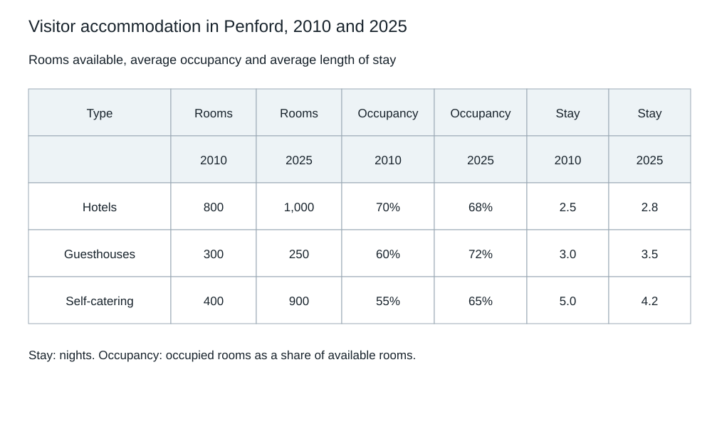

# IELTS Academic — Original Mock 09

Candidate paper • Original independent practice material • Answers and scripts are in separate examiner files.

Use the separate answer sheet. Do not open the examiner script during the test.

## Listening — 40 questions

Listen once. Four parts, ten questions each. Follow the word limits. See [ADMINISTRATION.md](../ADMINISTRATION.md) for the playback or reader-led protocol.

[Play the complete Listening test](audio/listening-full.mp3). Reading and checking pauses are already included. Play continuously without pausing or replaying during a timed sitting.

### Part 1 — Arranging a bicycle repair visit

[Part 1 audio](audio/part-1.mp3) — use for separate-part practice.

#### Questions 1–5

Complete the notes. Write ONE WORD AND/OR A NUMBER for each answer.

**1.** Customer’s surname: ____

**2.** Part reported to be slipping: ____

**3.** Type of bicycle: ____

**4.** Appointment day: ____

**5.** Appointment time: ____

#### Questions 6–10

Complete the notes. Write ONE WORD AND/OR A NUMBER for each answer.

**6.** Basic inspection and call-out price: £____

**7.** Mechanic should enter through the ____.

**8.** Covered working space: a ____

**9.** Customer must bring the ____.

**10.** Preferred payment method: ____

### Part 2 — Information for volunteers at a food festival

[Part 2 audio](audio/part-2.mp3) — use for separate-part practice.

#### Questions 11–15

Choose the correct letter, A, B or C.

**11.** Why will opening be later?

- **A** Road work affects access for setting up.
- **B** Stallholders requested fewer trading hours.
- **C** Low morning attendance is expected.

**12.** What transport addition does the coordinator highlight?

- **A** A larger public car park.
- **B** Free parking in every street.
- **C** A station shuttle.

**13.** What should volunteers do about ingredient questions?

- **A** Answer from the dish’s appearance.
- **B** Refer visitors to the producer.
- **C** Ask another visitor who has tasted it.

**14.** What happens when a cup is returned?

- **A** A voucher is issued for next year.
- **B** The visitor receives a free drink.
- **C** The deposit is repaid.

**15.** Where should an adult seeking a child be directed?

- **A** The staffed family point.
- **B** The public-address microphone.
- **C** The nearest food stall.

#### Questions 16–20

What instruction is given to each team? Write the correct letter. You may use any letter more than once.

- **A** Complete a safety briefing
- **B** Use protective equipment
- **C** Bring a personal camera
- **D** Work with a partner
- **E** Seek individual permission
- **F** Start later in the day

**16.** Welcome team

**17.** Tasting team

**18.** Survey team

**19.** Recycling team

**20.** Photography team

### Part 3 — Designing a visitor-label experiment

[Part 3 audio](audio/part-3.mp3) — use for separate-part practice.

#### Questions 21–25

Choose the correct letter, A, B or C.

**21.** What outcome is the main focus?

- **A** Which label visitors say they prefer.
- **B** How long visitors look at the object.
- **C** How much additional information a label contains.

**22.** What will remain similar across labels?

- **A** The amount and content of factual information.
- **B** The exact opening sentence.
- **C** The number of labels shown together.

**23.** Why use the staff training video?

- **A** To replace observations in the final study.
- **B** To find out which staff like the exhibit.
- **C** To practise and compare observation coding.

**24.** Why exclude guided school parties?

- **A** The museum does not allow children near the object.
- **B** Their stopping behaviour is directed by a guide.
- **C** School visitors never read labels.

**25.** What limitation does the tutor emphasise?

- **A** Longer viewing does not establish greater understanding.
- **B** Time spent looking cannot be observed at all.
- **C** Visitors in groups must all be excluded.

#### Questions 26–30

Complete the notes. Write ONE WORD AND/OR A NUMBER for each answer.

**26.** Any comprehension question should come ____ the observation period.

**27.** The chosen object is a wooden ____.

**28.** Its display ____ should remain constant.

**29.** Final observation schedule: ____ days

**30.** Departures from the plan should be entered in a ____.

### Part 4 — From textile waste to usable fibre

[Part 4 audio](audio/part-4.mp3) — use for separate-part practice.

#### Questions 31–40

Complete the notes. Write ONE WORD ONLY for each answer.

**31.** Wearable garments are first separated for possible ____.

**32.** Material ____ must then be assessed.

**33.** A fabric containing different fibres is a ____.

**34.** Sorting by colour can reduce later ____.

**35.** Hard items such as ____ are removed before cutting.

**36.** Fabric is mechanically pulled apart to release ____.

**37.** Mechanical opening tends to reduce fibre ____.

**38.** New fibre may be added to produce sufficiently strong ____.

**39.** Checks look for unwanted ____ in the output.

**40.** Records should account for useful output as well as removed components and ____.

## Reading — 60 minutes, 40 questions

Spend about 20 minutes on each passage. All answers must be on the answer sheet within the 60 minutes; there is no extra transfer time.

### Passage 1 — Cooling food before the grid arrived

**A** Before reliable electricity reached the fictional valley of Orlen, households used several methods to keep food cool. A shaded cellar worked well for some homes, while others stood pots in a stream. Neither arrangement was convenient for the women who sold fresh cheese at the weekly market. Their products travelled for hours in summer, and a cool destination could not undo warming during the journey. A local cooperative therefore investigated containers rather than planning a central cold store. The problem it chose to solve was movement between places, not storage at one fixed location.

**B** The first container used a porous outer clay pot, an inner vessel and damp sand between them. As moisture escaped from the outer surface, evaporation removed heat. The design depended on moving air and relatively dry conditions; it was not a miniature refrigerator that could work equally well anywhere. Trials on humid afternoons produced disappointing results. The cooperative kept those records alongside successful tests instead of advertising only the largest temperature fall. A shaded stand improved performance, but enclosing the pot in a sealed cupboard prevented the airflow on which its operation depended.

**C** Potter Elin Daro changed the design after watching sellers load their carts. A round pot could roll or tip during transport, and a lid that was easy to lift at home was difficult to secure on a rough track. She added a broad base and a fastening strap. These changes did not improve the cooling mechanism directly, but they reduced spills and breakage. The cooperative discovered that a technically effective object could still be rejected if handling it added work. Users judged the whole trip, including loading and cleaning, rather than one laboratory measurement of temperature.

**D** Water supply created another constraint. The sand had to remain damp, but sellers did not want dirty water near food. The revised inner vessel could be removed and washed separately, while a small reservoir fed moisture to the sand. A mark on the reservoir indicated the minimum level before a journey. Sellers were trained to inspect the outer surface for cracks and to replace a damaged vessel. These routines were simple but necessary. Calling the device passive did not mean that it required no attention; it meant that cooling did not depend on a powered compressor.

**E** To compare containers fairly, the cooperative placed equal quantities of cheese in them at the same initial temperature. Some travelled in carts, while others stayed on the shaded market stand. A thermometer was read at fixed intervals, and the test sheets recorded air temperature and humidity. The organisers did not ask sellers to taste products that had been stored beyond ordinary safety limits. Cooling performance and food safety were treated as related but distinct questions. A container could slow warming without demonstrating that every kind of food would remain safe for an entire day.

**F** The most useful improvement emerged from the trading schedule. Previously, sellers waited until all orders were ready before leaving the village together. Small producers sometimes kept finished cheese waiting for their neighbours. The cooperative organised two departure times, reducing that delay. Better scheduling lowered the demand placed on the containers without changing their construction. Some members initially considered this outside the cooling project, but later recognised that temperature exposure included time before loading. The device was one component of a chain whose other components involved decisions about work, transport and market opening hours.

**G** When electricity eventually became available, the clay containers did not disappear immediately. A powered store could hold larger quantities overnight, but the last part of the journey still involved unpowered carts and exposed stalls. Some members used both systems; others abandoned the pots because their routes had become shorter. The cooperative stopped describing one technology as the replacement for the other. Its records instead showed which combination suited which journey. A method could remain useful in a limited role even after a newer system expanded the range of things that the community could do.

**H** Orlen's fictional experience illustrates a familiar error in histories of technology: judging an invention only by the device that follows it. A clay cooler looks inadequate beside a modern refrigerator if both are imagined in identical conditions. Real users rarely face that abstract comparison. They consider purchase price, repair, water, travel and the consequences of failure. Understanding their choice requires attention to the service they need, not simply the age of the mechanism. Progress may mean gaining another useful option rather than replacing every earlier practice with a single supposedly universal solution.

#### Questions 1–5

Do these statements agree with the information in the passage? Write TRUE, FALSE or NOT GIVEN.

**1.** The cooperative's first priority was a permanent cooling building.

**2.** The clay cooler's effectiveness varied with atmospheric conditions.

**3.** The initial pot was developed using a foreign grant.

**4.** Daro's changes made the container easier to transport safely.

**5.** The term passive meant users never had to maintain the container.

#### Questions 6–10

Complete the notes. Write ONE WORD ONLY for each answer.

**6.** Heat was removed through ____ from the outer surface.

**7.** The device performed poorly inside a sealed ____.

**8.** A fastening ____ helped secure the lid.

**9.** Water reached the sand from a small ____.

**10.** Test sheets included air temperature and ____.

#### Questions 11–13

Choose the correct letter, A, B, C or D.

**11.** Why were two departure times introduced?

- **A** To increase the number of different cheeses produced.
- **B** To reduce the time some cheese spent waiting before travel.
- **C** To make all journeys take exactly the same time.
- **D** To avoid needing a market stand.

**12.** What happened after electricity became available?

- **A** All users immediately discarded the clay pots.
- **B** The cooperative prohibited unpowered transport.
- **C** The powered store was used only during journeys.
- **D** Different combinations were used for different circumstances.

**13.** What does the writer criticise in the final paragraph?

- **A** Evaluating an older technology without its context of use.
- **B** Recording the costs of maintaining simple devices.
- **C** Using more than one method within a supply chain.
- **D** Considering repair when deciding which device to buy.

### Passage 2 — The gap between knowing and remembering

**A** A student who can explain a concept immediately after a lesson may still struggle to recall it a week later. The difference is not necessarily evidence that the lesson failed. Immediate performance and durable access to knowledge are different outcomes, influenced by what happens during and after learning. In a fictional series of classroom investigations, psychologist Nia Vale examined how students judged these outcomes. She was particularly interested in why a method that feels smooth can produce strong confidence without producing equally strong later recall. Her research treated confidence as something to explain, not as a direct measure of learning.

**B** In the first investigation, students encountered short accounts of unfamiliar inventions. One group reread each account, while another closed the text and attempted to reconstruct its main points. The second group found the exercise harder and rated its expected later performance less favourably. A week later, however, it recalled more of the central relationships. Vale cautioned that this comparison did not mean reading was unnecessary: both groups needed an initial explanation. The question concerned what learners did after first encountering material, not whether an unsupported attempt could replace every form of instruction.

**C** Education researcher Tomas Iven questioned how general the result would be. Recalling a short account under quiet conditions differed from solving a demanding problem in a busy classroom. He designed a follow-up in which learners applied a rule to new examples, some superficially unlike those used in teaching. Performance depended partly on whether the practice required students to explain why the rule applied. Mere repetition of a familiar answer was less helpful. Iven argued that the content of a retrieval attempt mattered as much as the fact that the learner had been asked to remember something.

**D** Teacher Sara Omari noticed a practical difficulty in her own classes. When practice attempts were publicly graded, hesitant students sometimes avoided attempting an answer at all. She introduced short private exercises with feedback before using any marks. Students could see a correct explanation after they had committed to an attempt. The change was intended to make an error informative rather than socially costly. Omari did not conclude that all assessment should disappear. She distinguished the function of a practice attempt from that of a final judgement, particularly when students were still deciding whether they could risk exposing a misunderstanding.

**E** Another investigation concerned spacing. Learners completed the same amount of practice either in one session or across several days. Spreading it created more occasions on which knowledge had to be brought back after becoming less accessible. Yet the team rejected the slogan that longer gaps were always better. If a gap was so long that learners could recover nothing, frustration replaced useful effort. They adjusted intervals to the material and offered cues where needed. The aim was successful reconstruction with some difficulty, not maximum difficulty as an educational virtue in its own right.

**F** Analyst Joel Chen examined how the tests themselves might shape the findings. A later task that repeated practice questions exactly could favour a narrow routine. He therefore included questions requiring explanation in different wording and an application task with a changed surface context. Scores fell compared with the identical-question test, but differences between practice conditions did not vanish. Chen regarded both results as necessary: the fall showed limits, while the remaining difference suggested some transfer. Reporting only the more flattering test would make the intervention look broader than the evidence justified.

**G** Students' own study decisions changed only slowly. Many still preferred rereading because a familiar page felt reassuring and because generating an answer exposed gaps they would rather not notice. Vale asked them to predict performance on specific items and then compare those predictions with later results. The exercise made mistaken confidence visible without treating confidence itself as a personal flaw. Some students began using short self-tests voluntarily. Others needed more support, especially when they interpreted an unsuccessful attempt as proof of inability rather than information about what to study next.

**H** The fictional investigations do not supply a single timetable or universal recipe. Their shared message is that learning activities should be evaluated against the kind of later performance they are intended to support. An activity may be useful for introducing an idea, another for making it retrievable, and another for extending it to a new context. Feeling fluent during one of these activities is not worthless, but it cannot settle every question. Teachers and learners need evidence that extends beyond the pleasant experience of recognising material while it is still in front of them.

#### Questions 14–17

Which paragraph contains the following information? Write the correct letter. You may use any letter more than once.

- **A** Paragraph
- **B** Paragraph
- **C** Paragraph
- **D** Paragraph
- **E** Paragraph
- **F** Paragraph
- **G** Paragraph
- **H** Paragraph

**14.** a concern that classroom conditions differ from those of an initial study

**15.** a reason students avoided making practice attempts

**16.** a warning that excessive delay can make practice unhelpful

**17.** a method of exposing inaccurate predictions

#### Questions 18–21

Match each statement with the correct person. Write the correct letter. You may use any letter more than once.

- **A** Nia Vale
- **B** Tomas Iven
- **C** Sara Omari
- **D** Joel Chen

**18.** Introduced private practice before marked assessment

**19.** Compared identical test items with changed applications

**20.** Studied students' confidence in study methods

**21.** Emphasised explaining why a rule applied

#### Questions 22–26

Do these statements agree with the information in the passage? Write TRUE, FALSE or NOT GIVEN.

**22.** Vale claimed that initial reading could always be omitted.

**23.** The spaced-practice groups did more practice in total.

**24.** The application test produced lower scores than the identical-question test.

**25.** All students began using self-tests independently.

**26.** Chen's test papers were marked by external examiners.

### Passage 3 — The case for a repairable future

**A** To describe a product as durable is to make a claim about time, but the claim is incomplete until we know what happens when one part fails. An object may contain excellent materials and still become unusable because a small component cannot be replaced. Conversely, a less imposing object may remain useful through many repairs. Discussions of sustainable design often focus on the moment of manufacture or disposal. The period between them deserves equal attention: this is where ordinary decisions about access, information and maintenance determine how long a product actually serves a purpose.

**B** Repairability is sometimes reduced to the presence of screws rather than glue. Accessible fasteners do matter, but access to an internal part is only one step. A user must identify the fault, obtain a suitable replacement, perform the work safely and verify that the object functions afterwards. A product that can be opened easily may still be difficult to repair if its parts have no identifying marks. Design for repair is therefore a property of an arrangement of object, documentation, supply and skills. Treating it as a single visible feature produces reassuring labels without necessarily extending useful life.

**C** In a fictional procurement trial, a college compared two models of desk lamp. One was cheaper to purchase and had a sealed light unit. The other cost more but came with a replaceable module and a public parts list. The buyers calculated costs over several years rather than comparing only the invoice. Their result depended strongly on assumptions about failure rates and the continued availability of parts. They published those assumptions, allowing readers to see circumstances in which the cheaper lamp would remain cheaper. A calculation is more informative when its uncertainty is visible than when one favourable estimate is presented as inevitable.

**D** Manufacturers can reasonably raise safety concerns. Opening some devices exposes hazards, and an incorrect repair can create risks for users who never performed the work. But safety is not served by leaving a failing product in use because a responsible repair is impossible. The appropriate response depends on the task: some repairs can be supported with clear instructions, while others require trained personnel. A blanket appeal to danger avoids this distinction. The question is not whether every owner should attempt every repair, but whether a workable and proportionate route to repair exists.

**E** Information also has an economic role. A business may promise to keep spare parts available but provide no clear price or delivery time. If a replacement costs almost as much as a new object, formal availability gives little practical help. Public buyers can ask for price commitments and delivery expectations before purchasing, not only after equipment fails. These requests will not remove every future uncertainty. They can, however, make maintenance part of competition rather than leaving it as a private inconvenience discovered when the initial sale is complete and the buyer has few alternatives.

**F** Consumers are often blamed for preferring novelty, yet their choices reflect the options presented to them. A person offered an immediate replacement and an uncertain repair several weeks away may rationally choose the replacement even while valuing conservation. Convenient repair services can alter this calculation. Loan equipment, clear quotations and local collection points reduce the disruption involved. Moral appeals to keep things longer are unlikely to succeed if the surrounding service makes doing so unusually difficult. Responsibility belongs partly to users, but also to those who shape the time and effort a repair requires.

**G** There is a limit to the argument. Keeping every old appliance indefinitely is not necessarily sensible if use consumes far more resources than a replacement would. A comparison should include the impact of making the new product, the expected remaining life of the old one and the difference during use. The balance will vary by product and circumstance. This qualification does not defeat repairability. It prevents repair from becoming a slogan detached from outcomes. A repairable product preserves an option; deciding whether to exercise it still requires judgement about the actual situation rather than automatic loyalty to oldness.

**H** A serious repair policy would therefore change more than the construction of objects. It would make long-term support visible at the point of purchase and encourage institutions to retain maintenance knowledge. It would also distinguish repair opportunities from claims that every repair is worthwhile. The goal is neither to freeze technology nor to make consumers responsible for industrial design. It is to ensure that the failure of a small part does not unnecessarily dictate the fate of a whole product. Longevity becomes credible when there is a practical route from breakdown to renewed use.

#### Questions 27–31

Do these statements agree with the views of the writer? Write YES, NO or NOT GIVEN.

**27.** Material quality alone guarantees a long useful life.

**28.** Repairability involves more than gaining access to a product's interior.

**29.** The college's lamp trial was financed by a manufacturer.

**30.** Safety concerns justify prohibiting all repairs by owners.

**31.** In some circumstances replacing an old appliance can be reasonable.

#### Questions 32–36

Complete the notes. Write ONE WORD ONLY for each answer.

**32.** A user needs to ____ the fault before obtaining a replacement part.

**33.** The college considered costs beyond the original ____.

**34.** Some repairs should be performed by trained ____.

**35.** Public buyers can seek commitments about spare-part ____.

**36.** Lending equipment during repair can reduce ____.

#### Questions 37–40

Choose the correct letter, A, B, C or D.

**37.** Why were the procurement assumptions published?

- **A** To guarantee the lamps would never fail.
- **B** To avoid comparing the two products directly.
- **C** To make the conditions behind the result assessable.
- **D** To prove that sealed products always cost more.

**38.** What is the writer's view of users who choose replacement?

- **A** Their decision can reflect practical limits on repair.
- **B** They invariably misunderstand environmental questions.
- **C** They should always wait for repair regardless of delay.
- **D** Their preferences cannot change when services improve.

**39.** What does repairability primarily preserve?

- **A** An obligation to retain every old product.
- **B** A guarantee that repairing is always cheaper.
- **C** A reason to stop introducing new technology.
- **D** The ability to choose repair when it makes sense.

**40.** Which proposal best represents the final paragraph?

- **A** Judge longevity entirely by the heaviness of materials.
- **B** Include maintenance support in purchasing decisions.
- **C** Let consumers independently redesign unsafe parts.
- **D** Replace all institutional equipment on fixed dates.

## Writing — 60 minutes

Complete both tasks in connected prose. Suggested time: Task 1, 20 minutes (at least 150 words); Task 2, 40 minutes (at least 250 words). Task 2 has twice the weight in IELTS assessment.

### Task 1

The table gives information about three types of visitor accommodation in the fictional region of Penford in 2010 and 2025. Summarise the information by selecting and reporting the main features, and make comparisons where relevant. Write at least 150 words.

| Type | Available rooms 2010 | Available rooms 2025 | Average occupancy 2010 | Average occupancy 2025 | Average stay 2010 (nights) | Average stay 2025 (nights) |
| --- | ---: | ---: | ---: | ---: | ---: | ---: |
| Hotels | 800 | 1,000 | 70% | 68% | 2.5 | 2.8 |
| Guesthouses | 300 | 250 | 60% | 72% | 3.0 | 3.5 |
| Self-catering units | 400 | 900 | 55% | 65% | 5.0 | 4.2 |

Occupancy means the average proportion of available rooms occupied, not the share of all visitors.

### Task 2

Some people believe secondary schools should give students more choice over the subjects they study. Others think all students should follow a broad common curriculum. Discuss both views and give your own opinion. Give reasons and relevant examples. Write at least 250 words.

## Speaking — 11–14 minutes

The examiner keeps the question list. In Part 2 you receive the cue card below, one minute to prepare and up to two minutes to speak. Parts 1 and 3 are an interview.

### Part 2 cue card

Describe something you borrowed that was useful.

You should say:

- what it was

- who lent it to you

- how you used it

and explain why borrowing it was helpful.
