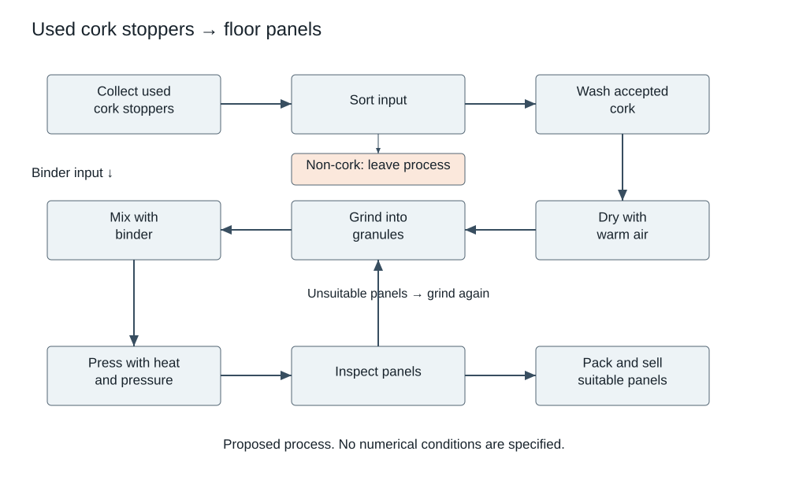

# IELTS Academic — Original Mock 10

Candidate paper • Original independent practice material • Answers and scripts are in separate examiner files.

Use the separate answer sheet. Do not open the examiner script during the test.

## Listening — 40 questions

Listen once. Four parts, ten questions each. Follow the word limits. See [ADMINISTRATION.md](../ADMINISTRATION.md) for the playback or reader-led protocol.

[Play the complete Listening test](audio/listening-full.mp3). Reading and checking pauses are already included. Play continuously without pausing or replaying during a timed sitting.

### Part 1 — Registering for a bookshop volunteer shift

[Part 1 audio](audio/part-1.mp3) — use for separate-part practice.

#### Questions 1–5

Complete the notes. Write ONE WORD AND/OR A NUMBER for each answer.

**1.** Surname: ____

**2.** Regular volunteering day: ____

**3.** First arrival time: ____

**4.** Initial work task: ____

**5.** Document to bring: one ____

#### Questions 6–10

Complete the notes. Write ONE WORD ONLY for each answer.

**6.** First-day entrance: the ____ door

**7.** Identification supplied by the shop: a ____

**8.** Heavy loads can be moved using a ____.

**9.** For a locker, bring a ____.

**10.** Report absence directly to the ____.

### Part 2 — Tour of the Westfield recreation centre

[Part 2 audio](audio/part-2.mp3) — use for separate-part practice.

Plan (not to scale). Face from reception towards the outdoor court. Boxes open off the central corridor.

```text
                 OUTDOOR COURT
       +-------------+   +-------------+
       |      A      |   |      B      |
       +-------------+   +-------------+
                  CORRIDOR
       +-------------+   +-------------+
       |      C      |   |      D      |
       +-------------+   +-------------+
                  CORRIDOR
       +-------------+   +-------------+
       |      E      |   |      F      |
       +-------------+   +-------------+
                   RECEPTION
```


#### Questions 11–15

Label the plan. Write the correct location letter. Write the correct letter. You may use any letter more than once.

- **A** Location on the plan
- **B** Location on the plan
- **C** Location on the plan
- **D** Location on the plan
- **E** Location on the plan
- **F** Location on the plan

**11.** Equipment store

**12.** Exercise studio

**13.** Changing area

**14.** First-aid room

**15.** Meeting room

#### Questions 16–20

Choose the correct letter, A, B or C.

**16.** Why was the booking window shortened?

- **A** The court still needs resurfacing.
- **B** The centre has fewer available staff.
- **C** Late cancellations had prevented others from booking.

**17.** What is said about equipment hire?

- **A** Ordinary hire is included, but losses are charged.
- **B** Members must buy equipment before joining.
- **C** Damaged items should be returned without comment.

**18.** What happens after repeated unexplained class absences?

- **A** The member must buy a new racket.
- **B** The member temporarily loses booking privileges.
- **C** Every remaining class is cancelled.

**19.** What is required for children’s-class handover?

- **A** An adult must simply remain somewhere in the building.
- **B** Children must find their own leader after entering.
- **C** An adult must check the child in with the leader.

**20.** What feedback does the centre particularly want?

- **A** Whether Saturday mornings are crowded.
- **B** Which quieter times people could actually attend.
- **C** Which room should replace reception.

### Part 3 — Testing a model bridge

[Part 3 audio](audio/part-3.mp3) — use for separate-part practice.

#### Questions 21–25

Choose the correct letter, A, B or C.

**21.** Where did the first model fail?

- **A** At a connection near the support.
- **B** At the centre of the main beam.
- **C** In the platform holding the weights.

**22.** Why use a loading template?

- **A** To hide the number of weights from observers.
- **B** To make every model carry a different load.
- **C** To keep weight placement consistent.

**23.** Why test several models?

- **A** To ensure a result can be chosen for appearance.
- **B** To avoid treating one construction flaw as a design rule.
- **C** To change all dimensions at the same time.

**24.** Which change will be tested first?

- **A** A different beam material.
- **B** A wider bridge and different supports.
- **C** A revised joint with other features unchanged.

**25.** How will a second failure criterion be defined?

- **A** By asking which model looks most impressive.
- **B** By choosing a deflection limit in advance.
- **C** By using whichever outcome produces the best report.

#### Questions 26–30

What action is agreed for each item? Write the correct letter. You may use any letter more than once.

- **A** Pilot it
- **B** Remove it
- **C** Treat it as completed
- **D** Calculate it after construction
- **E** Reserve it now
- **F** Replace it with photographs

**26.** Displacement sensor

**27.** Loading template

**28.** Safety screen

**29.** History section

**30.** Cost comparison

### Part 4 — Designing a household waste audit

[Part 4 audio](audio/part-4.mp3) — use for separate-part practice.

#### Questions 31–40

Complete the notes. Write ONE WORD ONLY for each answer.

**31.** First define the study’s ____ to establish included sources.

**32.** Researchers choose dates within a defined ____.

**33.** Recruiting only keen volunteers could ____ ordinary discarding.

**34.** Staff practise allocating waste to agreed ____.

**35.** The empty container’s weight must be ____ from the total.

**36.** Absorbed ____ can change measured mass.

**37.** Records identify households through ____ rather than names.

**38.** Comparison takes account of the number of ____.

**39.** Retrospective accounts may contain ____ errors.

**40.** After action, ____ measurement can establish whether waste actually declines.

## Reading — 60 minutes, 40 questions

Spend about 20 minutes on each passage. All answers must be on the answer sheet within the 60 minutes; there is no extra transfer time.

### Passage 1 — A harbour makes space for swimming

**A** For decades, residents of the fictional port of Esten thought of the inner harbour as a place to work beside rather than enter. Cargo traffic had moved to a larger terminal, but the old quays remained behind fences. When a group proposed an outdoor swimming area, objections concerned more than water quality. Fishing crews still needed access, local businesses feared noise, and some residents doubted that a harbour could feel welcoming. The proposal's supporters began with temporary opening days so that people could experience the site before deciding whether a permanent facility belonged there.

**B** Those early days used a floating enclosure close to a disused warehouse. Lifeguards supervised a small number of swimmers, and entry was free. The enclosure kept swimmers separate from boats but did not clean the water. Water testing was therefore essential, and the first opening was cancelled after heavy rainfall. Organisers displayed the cancellation reason at the gate rather than merely posting a notice online. This mattered because some visitors had travelled without checking the website. A disappointing first visit was less damaging to trust when the decision and its evidence were explained clearly.

**C** Engineers later traced several drainage routes from streets above the quay. Rain could carry contaminated runoff into the harbour, creating conditions that differed from those measured on dry days. The city improved some drains and introduced a closure protocol based on tests and recent conditions. It did not promise that the swimming area would always be open. Planners considered this uncertainty in the design: a closed pool should not turn the entire waterfront into a dead end. The surrounding deck remained accessible for walking and sitting even when swimming was suspended.

**D** Access to the water was another design problem. An ordinary ladder suited confident swimmers but not everyone who wanted to enter. The final enclosure included broad steps and a separate assisted-entry area. Changing cubicles were placed near the entrance, while lockers were visible from the staffed desk. The designers rejected a proposal to locate every service inside the old warehouse because it would force wet swimmers to cross a busy public route. The warehouse instead contained toilets and a classroom used for safety sessions, activities that did not require a direct path from the water.

**E** The project also changed who controlled the quay at different times. Fishing crews retained an early-morning unloading period, after which removable barriers opened a wider pedestrian route. A permanent wall would have simplified separation but prevented flexibility. Harbour staff and facility managers met each week during the first summer to resolve problems with delivery times and equipment storage. This routine was less visible than the new deck, yet it made shared use possible. The design depended on agreements that could be adjusted when a fishing boat arrived later than expected or a public event required more space.

**F** Counting visitors was straightforward; deciding whom the project served was not. An online survey produced many replies from confident swimmers who had visited repeatedly. Community worker Lena Moss also spoke to older residents at a nearby housing centre and parents at a school. Some liked the waterfront but did not want to swim. Others worried about the cost of lessons rather than admission. Their responses led to a small programme of free introductory sessions. The aim was not to persuade everyone to become a swimmer, but to remove an avoidable barrier for people who wanted to try.

**G** By the third summer, the swimming facility had become one attraction among several. A café leased part of the warehouse and helped cover running costs, but its tables occupied only a marked section of the deck. The council wanted to avoid turning a publicly funded waterfront into a place where every seat required a purchase. Free benches remained along the edge, including some outside the busiest view. Maintenance budgets covered replacement of weathered boards and checks of underwater fittings. These recurring expenses were included in public reports alongside attendance, rather than hidden behind the celebration of construction.

**H** Esten's fictional harbour was not transformed by a single architectural gesture. Its new use depended on testing, drainage work, access design, operating agreements and attention to people absent from the first survey. Nor did the change erase the port's working identity: fishing activity continued, and swimmers sometimes waited for a delivery to pass. The project suggests that opening a waterfront can mean negotiating a sequence of compatible uses rather than excluding everything that came before. Public access became credible because the city explained its limits and maintained the arrangements that allowed different activities to share a constrained space.

#### Questions 1–5

Choose the correct heading for each paragraph from the list below. Write the Roman numeral. Use each heading at most once.

- **i** Designing for different ways of entering
- **ii** Explaining an unwelcome decision
- **iii** Ending every commercial activity
- **iv** The practical work of sharing space
- **v** Testing public interest through experience
- **vi** Cleaning the water with a floating wall
- **vii** Keeping part of the site useful during closures

**1.** Paragraph A

**2.** Paragraph B

**3.** Paragraph C

**4.** Paragraph D

**5.** Paragraph E

#### Questions 6–9

Do these statements agree with the information in the passage? Write TRUE, FALSE or NOT GIVEN.

**6.** The floating enclosure itself purified harbour water.

**7.** The deck could be used when swimming was prohibited.

**8.** The warehouse was demolished during construction.

**9.** The café's rent covered the entire maintenance budget.

#### Questions 10–13

Complete the notes. Write ONE WORD ONLY for each answer.

**10.** The city developed a ____ protocol for unsafe conditions.

**11.** Lockers could be seen from the staffed ____.

**12.** Free introductory sessions responded partly to worries about the price of ____.

**13.** Reports included recurring maintenance expenses as well as ____.

### Passage 2 — Reading the ground without digging

**A** An archaeological site does not end at the objects visible on its surface. Buried walls, filled ditches and changes in soil may extend across a much wider area. Excavation can reveal them in detail, but it is slow and changes the deposits it examines. Archaeologists therefore use survey techniques to decide where questions are most promising before opening trenches. In an imagined investigation at North Field, a team compared several ways of reading the ground. None offered an underground photograph. Each measured a physical property from which the team had to infer a possible history.

**B** Survey specialist Ada Bell began with aerial images taken after a dry period. Some patches of vegetation had grown differently where buried features altered access to moisture. The marks were useful but inconsistent: a feature visible in one season could disappear in another. Bell compared images from several years and checked whether apparent lines followed modern farm machinery. A striking shape was not automatically ancient. She also recorded blank areas, resisting the temptation to draw a site boundary around only the most attractive marks. Absence in an image might reflect conditions rather than absence in the ground.

**C** Geophysicist Ben Ortiz then used an instrument that detected small magnetic variations. In suitable conditions, disturbed soil and some heated materials can differ from surrounding deposits. At North Field, however, recent metal fragments produced strong signals that obscured subtler ones. Ortiz mapped these disturbances rather than simply smoothing them away. The cleaned display was easier to read, but he retained the raw measurements so that later users could see how processing affected interpretation. A visually tidy image can communicate certainty that the underlying observations do not deserve, especially when unexplained noise has been removed.

**D** Another team, led by Celine Park, measured electrical resistance along selected lines. Moisture affects how easily current passes through soil, so a buried wall might differ from a filled ditch. Recent rain changed the overall readings, making comparisons between separate days difficult. Park introduced reference measurements in an unchanged strip of ground before each session. These did not solve every problem, but they helped identify variation associated with conditions rather than archaeology. Her results supported one of the magnetic features while leaving another uncertain. The disagreement was treated as a reason for a better question, not a competition to choose one winning instrument.

**E** Local historian Dev Rao contributed maps and accounts of land use. A rectangular feature that excited the team as a possible early building appeared at the location of a much later livestock enclosure. The map did not prove the interpretation, because its scale and alignment were imperfect. It nevertheless offered an alternative that had to be considered. Rao also interviewed farmers who remembered changes in drainage. Their recollections were recorded with dates and qualifications rather than treated as either unquestionable truth or mere anecdote. Different evidence carried different uncertainties, and comparison required preserving those distinctions.

**F** The team eventually opened two small trenches. One confirmed a stone foundation, while the other exposed a modern drain where a promising linear signal had appeared. This mixed result was more useful than a simple success story. It showed that the survey had located real differences in the ground without always identifying their cause correctly. The trench records were linked to the survey archive, including the unsuccessful interpretation. Future researchers would therefore be able to revisit the decision process instead of seeing only the feature that justified the team's original enthusiasm.

**G** There was also a question of where not to dig. A patch containing fragile deposits was left untouched because the immediate research question could be answered elsewhere. Non-invasive survey did not make excavation unnecessary; it helped target an irreversible action. The landowner wanted assurance that the whole field would not be opened, and a public explanation described the planned limits. Protecting archaeological information involved preserving some uncertainty. A feature could remain an informed possibility until a future project had a compelling reason and a suitable method to investigate it more directly.

**H** North Field's fictional investigation illustrates the difference between detecting a pattern and explaining it. Instruments extend perception, but their outputs become evidence through decisions about conditions, processing and comparison. A survey image can look authoritative while concealing several plausible interpretations. Good reporting makes that uncertainty usable rather than merely adding a vague warning at the end. The result is a map of questions as well as features: where evidence agrees, where it conflicts, and where a future observer might learn something new without repeating damage that has already been done.

#### Questions 14–17

Which paragraph contains the following information? Write the correct letter. You may use any letter more than once.

- **A** Paragraph
- **B** Paragraph
- **C** Paragraph
- **D** Paragraph
- **E** Paragraph
- **F** Paragraph
- **G** Paragraph
- **H** Paragraph

**14.** a record intended to show the effects of data processing

**15.** a reason for avoiding excavation in a particular place

**16.** a modern historical explanation for an apparently older feature

**17.** an example of excavation contradicting an initial interpretation

#### Questions 18–21

Match each statement with the correct researcher. Write the correct letter. You may use any letter more than once.

- **A** Ada Bell
- **B** Ben Ortiz
- **C** Celine Park
- **D** Dev Rao

**18.** Compared images captured in different years

**19.** Made reference measurements before each session

**20.** Recorded recollections about drainage changes

**21.** Identified interference caused by recent metal

#### Questions 22–26

Complete the notes. Write ONE WORD ONLY for each answer.

**22.** Vegetation marks partly reflected differences in access to ____.

**23.** Ortiz's instrument measured variations in the ground's ____ properties.

**24.** Park measured electrical ____.

**25.** The team linked trench records to the survey ____.

**26.** A good survey maps questions as well as ____.

### Passage 3 — Who should explain a decision?

**A** When an institution uses a model to rank applications, explanation can appear to be an optional courtesy added after the result. A person receives a decision and perhaps a sentence describing the system's general purpose. Yet decisions allocate opportunities, and an explanation may be necessary for identifying an error or challenging an inappropriate rule. The question is not simply whether the model can produce a plausible account of its operation. It is whether the institution gives the affected person information that serves a practical purpose, together with a route for acting on it.

**B** Different audiences require different explanations. An engineer investigating a calculation may need a detailed account of data transformations. An applicant may need to know that an outdated address caused the system to assign the wrong eligibility category. Providing the engineer's report to the applicant can satisfy a formal requirement while failing to help. Technical completeness and practical intelligibility are not identical. An institution should begin by asking what the recipient must be able to understand or do, rather than assuming that more mathematical detail always makes a decision more accountable.

**C** Consider a fictional scholarship programme. Its ranking model awards additional weight to applicants from areas with limited educational resources. An applicant who recently moved is assigned to a better-resourced area using an old record. Explaining that neighbourhood data influenced the score is useful, but incomplete. The applicant needs to know which address was used and how to correct it. More importantly, the programme needs a procedure for reviewing the decision after correction. Information without a responsive process may merely describe an injustice accurately while leaving its consequence unchanged.

**D** Explanation also has limits when the rule itself is disputed. A perfectly accurate account of a policy does not make the policy fair. People may agree on how a model treated distance from a training centre while disagreeing on whether distance should count at all. This disagreement cannot be resolved by showing that the software performed its calculation correctly. It requires institutional reasons and, where appropriate, public debate. Technical auditing remains valuable, but it answers a narrower question than the legitimacy of the objective that the institution has instructed the system to pursue.

**E** Some critics argue that explanations will enable people to manipulate a system. The concern is real when a disclosed threshold allows someone to alter a superficial signal without meeting the policy's purpose. Nevertheless, secrecy can also shield errors and arbitrary rules. Institutions need to distinguish exploitable operational details from information necessary for a meaningful challenge. An applicant should not have to accept a demonstrably false record merely because the ranking method is commercially sensitive. The burden of finding an appropriate form of disclosure belongs primarily to the institution using the system, not to the person affected by it.

**F** Nor is an appealing explanation necessarily faithful. A model can generate a simple story that sounds reasonable without identifying what actually determined its output. If staff repeat such stories without checking them, explanation becomes a technique for discouraging questions. A useful account should be tested against the decision process and should state where certainty is limited. In some cases the honest answer is that a particular contribution cannot be isolated reliably. That admission may be less satisfying than a confident narrative, but it gives a reviewer a more accurate basis for deciding whether further investigation is needed.

**G** Human review is often offered as a remedy, although the phrase can conceal very different arrangements. A reviewer with no time, authority or additional information may simply confirm the original result. Meaningful review requires the ability to change it and a reasoned record of the judgement. It also requires attention to recurring patterns: correcting one applicant's address should lead the programme to ask whether similar errors affect others. Otherwise an appeal system can become a costly way of repairing individual cases while leaving a predictable source of harm operating unchanged.

**H** Accountability therefore belongs to an institution, even when a complex model makes part of its work difficult to describe. A supplier may assist with analysis, but cannot absorb the public body's responsibility to justify the service it provides. Good explanations connect facts, rules and remedies in language suited to the recipient. Their value lies not in making every refusal pleasant or every dispute disappear, but in making mistakes contestable and policy choices visible. A decision becomes more accountable when the person receiving it can do more than admire the sophistication of the machinery behind it.

#### Questions 27–31

Do these statements agree with the views of the writer? Write YES, NO or NOT GIVEN.

**27.** An explanation can be necessary for challenging an error.

**28.** Greater mathematical detail always makes a decision more accountable.

**29.** The fictional scholarship programme received more than a thousand applications.

**30.** Correct implementation proves that a policy objective is legitimate.

**31.** An honest account may need to acknowledge uncertainty.

#### Questions 32–35

Choose the correct letter, A, B, C or D.

**32.** What does the old-address example demonstrate?

- **A** Eligibility should never depend on where a person lives.
- **B** Applicants are responsible for designing ranking systems.
- **C** Technical data should be kept separate from review staff.
- **D** Knowing the source of an error is insufficient without a remedy.

**33.** What distinction is made in paragraph D?

- **A** Public debate is less reliable than every technical audit.
- **B** The correctness of a calculation differs from the fairness of its rule.
- **C** Distance cannot be measured accurately by software.
- **D** All applicants agree about the purpose of scholarship schemes.

**34.** How should institutions respond to manipulation concerns?

- **A** Separate sensitive details from information required for challenge.
- **B** Withhold all reasons whenever a supplier requests secrecy.
- **C** Publish every operational threshold without considering effects.
- **D** Require applicants to explain the model before appealing.

**35.** What is the danger of a plausible but unfaithful explanation?

- **A** It forces reviewers to investigate too many accurate records.
- **B** It makes a faithful technical account impossible to produce.
- **C** It can discourage scrutiny without revealing the actual process.
- **D** It proves that the underlying decision must be incorrect.

#### Questions 36–40

Complete the notes. Write ONE WORD ONLY for each answer.

**36.** A human reviewer needs the ____ to change a result.

**37.** Review should identify recurring ____ rather than correcting only individual cases.

**38.** The institution retains ____ even when a supplier assists with analysis.

**39.** Explanations should connect facts, rules and ____.

**40.** The final goal is to make policy choices ____.

## Writing — 60 minutes

Complete both tasks in connected prose. Suggested time: Task 1, 20 minutes (at least 150 words); Task 2, 40 minutes (at least 250 words). Task 2 has twice the weight in IELTS assessment.

### Task 1

The diagram shows a proposed industrial process for turning used cork stoppers into floor panels. Summarise the information by selecting and reporting the main features, and make comparisons where relevant. Write at least 150 words.



Accessible diagram transcription:

1. Collect used cork stoppers.
2. Sort: reject non-cork items (leave the process).
3. Wash accepted cork.
4. Dry with warm air.
5. Grind into granules.
6. Mix granules with a supplied binder.
7. Press the mixture into panels using heat and pressure.
8. Inspect panels: suitable panels go to packing and sale; unsuitable panels are ground again and returned to the mixing stage.

The binder enters only at mixing. The diagram supplies no times, temperatures or quantities.

### Task 2

More employers are offering flexible working hours. Do the advantages of this development outweigh the disadvantages? Give reasons and relevant examples. Write at least 250 words.

## Speaking — 11–14 minutes

The examiner keeps the question list. In Part 2 you receive the cue card below, one minute to prepare and up to two minutes to speak. Parts 1 and 3 are an interview.

### Part 2 cue card

Describe a decision you made that took some time.

You should say:

- what you had to decide

- what options you considered

- who or what helped you

and explain why you took time to make the decision.
