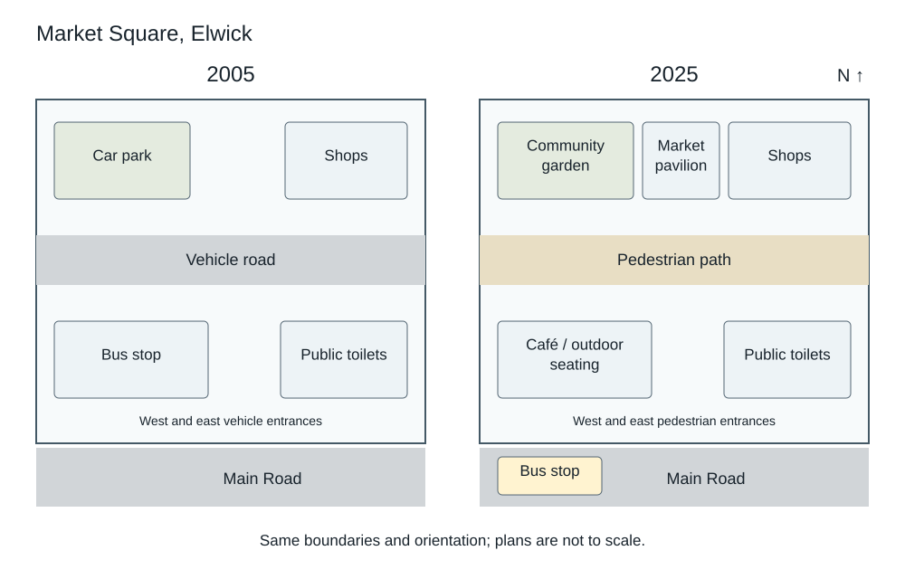

# IELTS Academic — Original Mock 11

Candidate paper • Original independent practice material • Answers and scripts are in separate examiner files.

Use the separate answer sheet. Do not open the examiner script during the test.

## Listening — 40 questions

Listen once. Four parts, ten questions each. Follow the word limits. See [ADMINISTRATION.md](../ADMINISTRATION.md) for the playback or reader-led protocol.

[Play the complete Listening test](audio/listening-full.mp3). Reading and checking pauses are already included. Play continuously without pausing or replaying during a timed sitting.

### Part 1 — Booking a short residential course

[Part 1 audio](audio/part-1.mp3) — use for separate-part practice.

#### Questions 1–5

Complete the notes. Write ONE WORD AND/OR A NUMBER for each answer.

**1.** Surname: ____

**2.** Recommended station: ____

**3.** Earliest key collection: ____

**4.** Residential fee: £____

**5.** Deposit: £____

#### Questions 6–10

Complete the notes. Write ONE WORD ONLY for each answer.

**6.** Room type requested: ____

**7.** Meal preference to state on the form: ____

**8.** Personal listening equipment to bring: ____

**9.** Bags can remain in the ____ after checkout.

**10.** For the speaking activity, bring a ____ of a familiar place.

### Part 2 — A guide to the town’s open-building weekend

[Part 2 audio](audio/part-2.mp3) — use for separate-part practice.

#### Questions 11–15

What feature is mentioned for each building? Write the correct letter. You may use any letter more than once.

- **A** Includes a practical activity
- **B** Requires advance reservation
- **C** Has an evening opening
- **D** Provides overnight accommodation
- **E** Has unavoidable stair access
- **F** May close because of weather

**11.** Old courthouse

**12.** Clock workshop

**13.** Recording studio

**14.** Water tower

**15.** Municipal greenhouse

#### Questions 16–20

Choose the correct letter, A, B or C.

**16.** Why is the circular bus recommended?

- **A** Every visitor must see all sites.
- **B** All walking routes are closed.
- **C** It makes visits to separated sites easier to combine.

**17.** When should reserved-tour visitors arrive?

- **A** At least an hour early.
- **B** About ten minutes before the start.
- **C** At any time during the first half-hour.

**18.** What is said about photography?

- **A** Not everything visible is available to photograph.
- **B** All employee photographs are automatically permitted.
- **C** Only professional cameras are allowed.

**19.** Why is age guidance provided?

- **A** To exclude all children from working buildings.
- **B** To judge children’s behaviour in advance.
- **C** To explain the suitability of the particular tour.

**20.** What feedback is particularly useful?

- **A** A ranking of guides by appearance.
- **B** Specific questions about activities inside the buildings.
- **C** Requests for identical visits at every site.

### Part 3 — Preparing a student radio feature

[Part 3 audio](audio/part-3.mp3) — use for separate-part practice.

#### Questions 21–25

Choose the correct letter, A, B or C.

**21.** Why did the students change their focus?

- **A** No historical records were available.
- **B** The night service had been cancelled entirely.
- **C** The original approach was mainly chronological.

**22.** How will arrival sound be used?

- **A** Continuously underneath every interview.
- **B** Briefly to establish the scene.
- **C** Instead of any spoken description.

**23.** What is the tutor’s privacy concern?

- **A** Other details may identify an unnamed speaker.
- **B** Only written interviews can be anonymous.
- **C** Passengers must always use their full names.

**24.** How should the official account be handled?

- **A** Exclude it because it is official.
- **B** Treat it as the only reliable perspective.
- **C** Check its supporting records and other evidence.

**25.** What should guide cuts?

- **A** Keeping every favourite anecdote.
- **B** The purpose and central question of the feature.
- **C** Removing only sentences that are easy to edit.

#### Questions 26–30

What action is agreed for each item? Write the correct letter. You may use any letter more than once.

- **A** Test it with a new listener
- **B** Decide after the main edit
- **C** Consider it verified
- **D** Obtain further permission
- **E** Remove it
- **F** Give it to the transport office

**26.** Opening sequence

**27.** Passenger extract

**28.** Timetable facts

**29.** Long music introduction

**30.** Public title

### Part 4 — Place names as historical evidence

[Part 4 audio](audio/part-4.mp3) — use for separate-part practice.

#### Questions 31–40

Complete the notes. Write ONE WORD ONLY for each answer.

**31.** Different historical forms of a name may vary in their ____.

**32.** Sources include maps, deeds and ____.

**33.** Interviews can preserve local ____.

**34.** A resemblance between a name and a familiar modern word may be ____.

**35.** Old references may describe a different geographical ____.

**36.** A council ____ does not show what everyone actually said.

**37.** Minority communities may connect a name with their ____.

**38.** Researchers should explain ____ in disputed interpretations.

**39.** Each claim in the catalogue should link to its ____.

**40.** The catalogue should retain ____ when evidence is inconclusive.

## Reading — 60 minutes, 40 questions

Spend about 20 minutes on each passage. All answers must be on the answer sheet within the 60 minutes; there is no extra transfer time.

### Passage 1 — A library beyond its walls

**A** The fictional district of Wendon contained a modern central library and several villages whose residents rarely visited it. Bus services were infrequent, and opening hours overlapped with many people's working day. The district's first response was to advertise its online collection more widely. That helped some readers but assumed access to reliable connections and suitable devices. Librarian Noor Hale proposed a different experiment: small staffed collection points in places people already used. The aim was not to reproduce a full library in every village, but to reduce the effort needed to obtain particular services.

**B** A room beside a food shop became the first collection point. Residents could request books from the central catalogue and collect them during two weekly sessions. Hale rejected the suggestion that requests should be made exclusively online. A telephone line and paper slips allowed people to use the service without learning a new interface. Staff entered those requests into the same system, so stock records remained consistent. This extra work was counted in the project budget rather than treated as free labour that would somehow be absorbed by existing staff alongside all their other duties.

**C** Choosing a venue involved compromises. A village hall had more space, but stood on the outskirts and opened mainly for planned events. The food shop offered less room but attracted regular visits. The library paid a modest rent for the adjoining room and installed a lockable cabinet for requested items. Books were not left on open shelves overnight. A small selection was available for browsing during staffed sessions, yet most of the stock remained at the central building. This preserved the benefit of a shared collection rather than dividing it into tiny permanent holdings.

**D** Transport initially followed a fixed route on one morning each week. A missed request could therefore produce a long wait. The team added a late request deadline for urgent educational materials and arranged space in a council vehicle already travelling between offices. This did not create an on-demand courier service, but reduced some avoidable delays without requiring a dedicated journey. The timetable was printed beside request forms. Residents could see when an item was likely to arrive instead of receiving an optimistic promise that staff could not reliably keep.

**E** The collection point also attracted questions unrelated to borrowing. People asked for help understanding forms, finding local history photographs and using audio books on a phone. Hale trained staff to recognise when they could help and when a specialist referral was needed. The library did not collect copies of private financial documents or complete applications on residents' behalf. A quiet screen allowed conversations to be less audible to other visitors. These boundaries protected both users and staff while acknowledging that access to information often begins with a question more complicated than a book title.

**F** After six months, the district compared borrowing records with a short household survey. Borrowing had increased, but the survey showed that some residents still did not understand which services were available. Others knew about the point but could not attend either weekly session. One opening was moved to an evening after consultation with shop staff. The evaluation also distinguished new users from existing library members who had simply switched collection location. Both groups benefited, but confusing them would exaggerate how many previously excluded people the experiment had reached.

**G** Expansion brought a new concern: volunteers offered to run additional points without paid staff. Their enthusiasm was welcome, yet Hale argued that a reliable public service could not depend entirely on whoever happened to be free. Volunteers helped with publicity and reading events, while trained employees retained responsibility for records, privacy and referrals. The district expanded to three more venues, with a published rota and cover for absence. Growth was slower than a volunteer-only model might have allowed, but opening times became a commitment residents could plan around rather than an informal possibility.

**H** Wendon's experiment did not make the central library redundant. Its collection, professional expertise and specialist spaces supported the smaller points. Nor could a collection cabinet provide everything that a welcoming building offered. The district described the service as a network with different functions rather than a contest between physical and digital access. Its achievement lay in connecting shared resources to ordinary journeys and offering several ways to ask for help. The lesson was not that libraries require fewer people, but that their people and materials can be organised around the obstacles that prevent use.

#### Questions 1–5

Do these statements agree with the information in the passage? Write TRUE, FALSE or NOT GIVEN.

**1.** The original online publicity helped every resident equally.

**2.** Residents were able to make requests by telephone.

**3.** The food shop provided its adjoining room without payment.

**4.** The central library had a larger collection than any neighbouring district.

**5.** All increases in borrowing came from people who had never used the library.

#### Questions 6–10

Complete the notes. Write ONE WORD ONLY for each answer.

**6.** Requested books were stored overnight in a lockable ____.

**7.** Urgent educational items could sometimes travel in a council ____.

**8.** Staff could direct difficult enquiries to a specialist through a ____.

**9.** A quiet ____ helped make conversations less audible.

**10.** The six-month evaluation included a household ____.

#### Questions 11–13

Choose the correct letter, A, B, C or D.

**11.** Why did the evaluation distinguish different types of users?

- **A** To stop existing members using the collection points.
- **B** To set different borrowing charges for each group.
- **C** To assess accurately how far the service reached excluded people.
- **D** To compare readers according to the value of their books.

**12.** What was Hale's concern about expansion?

- **A** Unpaid enthusiasm alone could not guarantee a reliable service.
- **B** Volunteers should be excluded from all library activities.
- **C** Professional staff should work only at the central building.
- **D** A rota would make residents less willing to visit.

**13.** How is the service best described in the final paragraph?

- **A** A substitute for all face-to-face library work.
- **B** A temporary service until every user goes online.
- **C** A series of independent miniature collections.
- **D** A network connecting shared resources with different access routes.

### Passage 2 — Watching change one picture at a time

**A** Pictures contributed by the public can form a record of environmental change, but an attractive collection of images is not automatically a comparable dataset. A photograph of a tree may show its leaves clearly while revealing little about the date, location or conditions of observation. In a fictional project called Seasonal Streets, researchers invited residents to photograph selected trees throughout the year. The project sought to understand local differences in seasonal events, not to identify the single earliest leaf in the country. Its success depended on ordinary observations being repeated in sufficiently consistent ways.

**B** Project scientist Lina Moss designed a simple protocol. Participants chose a marked viewing position and included the same branch in each picture. They also recorded the date and whether buds, open leaves or fallen leaves were visible. Moss knew that these categories compressed a continuous process into discrete labels. She supplied examples of borderline stages and allowed an uncertain category. Requiring a definite answer for every image would create apparent precision by hiding genuine disagreement. The project preferred a visible gap in certainty to a confident classification that the photograph could not support.

**C** Photographer Evan Cole worried that participants would move to obtain a more appealing composition. He demonstrated why a less beautiful but consistent viewpoint was often more useful. If one week showed a sunny outer branch and the next showed the shaded centre of the tree, an apparent change could reflect framing rather than development. Cole made a short guide using deliberately ordinary photographs. The purpose was not to train residents as professional photographers. It was to show which visual decisions affected the comparison and which, such as including an untidy fence in the background, usually did not matter.

**D** Analyst Priya Nair examined missing observations. Trees near busy routes attracted more photographs, while those at the end of quiet streets were often neglected. A period of bad weather produced fewer submissions even though seasonal change continued. Nair warned against interpreting the average of submitted pictures as if the same places had been observed on every date. She tracked each tree separately and reported the number of observations behind each summary. Participants could then see why a smooth town-wide curve might conceal irregular evidence and why more photographs did not necessarily mean a more representative sample.

**E** Community organiser Hugo Reyes concentrated on who could participate. A phone-based submission tool was convenient, but some residents preferred a camera and a paper record. The project offered monthly drop-in sessions where staff uploaded those images with the contributor. Reyes also arranged pairs so that a participant away from home could ask another person to photograph the same branch. These arrangements made continuity a shared responsibility. They did not eliminate all barriers, but they avoided treating ownership of a recent smartphone and constant personal availability as necessary qualifications for noticing a local tree.

**F** The first year's results showed earlier leaf development on several sheltered streets. The team resisted attributing the entire difference to temperature because tree species, age and management also varied. A second phase added paired observations of the same species in contrasting locations. It also recorded pruning, which could remove the photographed branch or change the exposure of the remaining leaves. These additions emerged from uncertainty in the first phase rather than from an attempt to make the initial findings sound more decisive. An exploratory project can be useful by revealing what a later comparison needs to control.

**G** Participants reported benefits that were not part of the scientific measurement. Some began noticing insects or discussing the street's history with neighbours. The team welcomed these outcomes but kept them separate from claims about the quality of the seasonal data. A socially valuable activity can still generate uneven evidence, and a rigorous measurement can still be unwelcoming to many residents. Evaluating both purposes required more than a single participation total. The organisers asked what people learned, which observations were usable and whose experience remained absent, without expecting one measure to answer all three questions.

**H** Seasonal Streets illustrates a productive relationship between public participation and technical care. Standardisation did not require eliminating every personal contribution; it identified the details that had to remain stable for a particular question. Flexibility elsewhere made participation possible. The photographs became evidence through context, repetition and honest reporting of omissions. Their greatest strength was not that many people could collect pictures cheaply. It was that repeated local attention could connect an abstract question about change with a visible object in everyday life, while leaving enough information for someone else to assess the resulting claim.

#### Questions 14–17

Which paragraph contains the following information? Write the correct letter. You may use any letter more than once.

- **A** Paragraph
- **B** Paragraph
- **C** Paragraph
- **D** Paragraph
- **E** Paragraph
- **F** Paragraph
- **G** Paragraph
- **H** Paragraph

**14.** an alternative method for people without a suitable phone

**15.** a reason for allowing an uncertain observation category

**16.** a change made to improve comparison in the next project phase

**17.** a distinction between social benefit and scientific data quality

#### Questions 18–21

Match each statement with the correct person. Write the correct letter. You may use any letter more than once.

- **A** Lina Moss
- **B** Evan Cole
- **C** Priya Nair
- **D** Hugo Reyes

**18.** Recorded the quantity of evidence behind each summary

**19.** Demonstrated why consistent framing mattered

**20.** Organised contributors to provide cover for one another

**21.** Defined observation categories and examples of difficult cases

#### Questions 22–26

Do these statements agree with the information in the passage? Write TRUE, FALSE or NOT GIVEN.

**22.** Participants had to photograph exactly the same branch each time.

**23.** Bad weather reduced the number of submitted observations.

**24.** The team concluded that temperature alone explained all street differences.

**25.** Pruning was included in the second phase's records.

**26.** Participants were paid for each usable photograph.

### Passage 3 — Is convenience always a gain?

**A** Convenience is usually presented as an obvious benefit: a task takes less time, demands fewer steps or can be completed from home. These improvements can matter greatly, particularly to someone with limited mobility or inflexible working hours. Yet a service can become more convenient for its typical user while becoming harder for others to use. A change may also move effort from a paid worker to the customer without making that effort disappear. To evaluate convenience seriously, we need to ask whose effort is counted, when it occurs and which alternatives remain available.

**B** Consider a fictional sports centre that replaces its staffed booking desk with an application. Regular players can reserve a court in seconds, even when the building is closed. For them, the change is a clear improvement. A visitor with an older phone, an unfamiliar payment card or limited reading ability may face several failed attempts before receiving help. Counting the average booking time among successful app users excludes these attempts by definition. The resulting figure can be accurate as a description of one group and misleading as a description of the service as a whole.

**C** This is not a reason to preserve every inconvenient process. Staffed desks also impose costs: journeys, queues and restricted hours. The stronger conclusion is that comparisons need a complete account of the work involved. A user who spends twenty minutes setting up an account may recover that time over many later bookings, while an occasional visitor may never do so. Initial effort and repeated effort should therefore be distinguished. The same design can be highly convenient for frequent use and poorly suited to a task someone needs only once a year.

**D** Automation can also remove small conversations that previously performed an unrecognised function. A receptionist might notice that a new player has booked an unsuitable court or explain a cancellation rule before payment. An application can provide equivalent guidance, but only if the designers know the conversation mattered. Replacing a desk with a form while copying only its visible transaction may omit the informal checking around it. What looked like wasted time may have prevented later mistakes. The task is to identify useful interactions, not to assume that every human exchange is either essential or inefficient.

**E** There is a further issue of control. A convenient subscription renewal can prevent an interruption, but a difficult cancellation can turn convenience into one-sided dependence. Friction is the effort a process imposes. Removing it from joining while retaining it in leaving serves the provider more clearly than the customer. Some friction is legitimate, such as confirming a decision with serious consequences. Its justification should depend on the decision's risk rather than on whether the provider benefits from delay. A service that makes actions easy only when profitable offers a selective kind of convenience.

**F** Support routes matter especially when a standard process fails. A beautifully designed form cannot anticipate every circumstance, and repeating the same instructions is not useful when the instructions assume something false about the user. An effective exception route allows a person to describe the problem to someone with authority to resolve it. This route may be used rarely and still be essential. Its value should not be judged solely by the proportion of routine transactions it handles, just as an emergency exit is not evaluated by how often people choose it for ordinary entry.

**G** Organisations often reply that maintaining alternatives is expensive. Sometimes that is true, and resources are finite. But the cost comparison should include work displaced onto users and the later costs of unresolved errors. Offering a telephone route for occasional exceptions may be cheaper than rebuilding every digital screen, while clearer instructions may reduce calls. There is no universal requirement to operate every possible channel forever. There is a requirement to examine the consequences of removing a channel instead of treating the savings on one departmental budget as the whole social result.

**H** Convenience is best understood as a relationship between a service and a situation, not a permanent property of an interface. A well-designed system can make routine tasks quick, preserve reasonable alternatives and handle unusual cases without humiliation or excessive delay. It should be evaluated with unsuccessful attempts visible, not only completed transactions. The aim is not to celebrate difficulty or resist technology. It is to make the promise of reduced effort honest: an improvement should not be declared complete merely because the people still struggling have disappeared from the measurement.

#### Questions 27–30

Choose the correct heading for each paragraph from the list below. Write the Roman numeral. Use each heading at most once.

- **i** The hidden function of a conversation
- **ii** Why all automation should be reversed
- **iii** An average that leaves out failure
- **iv** The same benefit for every visitor
- **v** A ban on subscription services
- **vi** Different costs for frequent and occasional use
- **vii** Effort applied in the provider's favour

**27.** Paragraph B

**28.** Paragraph C

**29.** Paragraph D

**30.** Paragraph E

#### Questions 31–35

Do these statements agree with the views of the writer? Write YES, NO or NOT GIVEN.

**31.** Digital convenience can be a substantial benefit for some users.

**32.** Every staffed booking desk should remain unchanged.

**33.** The sports centre's application was developed by its receptionist.

**34.** A rarely used route for exceptional problems can still be important.

**35.** Departmental savings alone capture all the consequences of removing a channel.

#### Questions 36–40

Complete the notes. Write ONE WORD ONLY for each answer.

**36.** The writer defines friction as the ____ imposed by a process.

**37.** An exception handler needs ____ to resolve a problem.

**38.** The importance of an exception route is compared with an emergency ____.

**39.** Organisations should count work ____ onto users.

**40.** Evaluation should include unsuccessful ____.

## Writing — 60 minutes

Complete both tasks in connected prose. Suggested time: Task 1, 20 minutes (at least 150 words); Task 2, 40 minutes (at least 250 words). Task 2 has twice the weight in IELTS assessment.

### Task 1

The plans show the layout of Market Square in the fictional town of Elwick in 2005 and 2025. Summarise the information by selecting and reporting the main features, and make comparisons where relevant. Write at least 150 words.

The plans use the same boundaries and orientation (north at the top). Main Road remains along the south edge.

| Position inside square | 2005 | 2025 |
| --- | --- | --- |
| Northwest | Car park | Community garden |
| Northeast | Shops | Shops, same footprint |
| Centre | Road connecting west and east entrances | Pedestrian path connecting west and east entrances |
| Southwest | Bus stop | Café with outdoor seating |
| Southeast | Public toilets | Public toilets, same footprint |
| North-central | No structure | Covered market pavilion |

In 2025 the bus stop is on Main Road outside the square, immediately south of its former position. Vehicle entrances at the east and west have become pedestrian entrances. No scale or building dimensions are supplied.

### Task 2

Some people think communities should organise more activities that bring different age groups together. Others believe separate activities for people of similar ages are more beneficial. Discuss both views and give your own opinion. Give reasons and relevant examples. Write at least 250 words.

## Speaking — 11–14 minutes

The examiner keeps the question list. In Part 2 you receive the cue card below, one minute to prepare and up to two minutes to speak. Parts 1 and 3 are an interview.

### Part 2 cue card

Describe a local change that you welcomed.

You should say:

- what changed

- when you first noticed it

- who benefited from it

and explain why you were pleased about the change.
