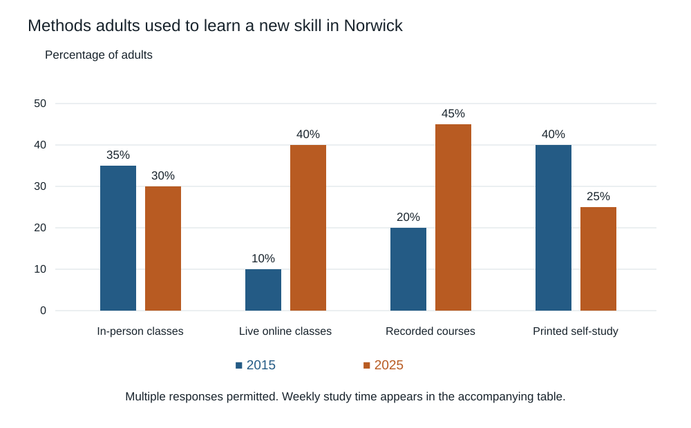

# IELTS Academic — Original Mock 12

Candidate paper • Original independent practice material • Answers and scripts are in separate examiner files.

Use the separate answer sheet. Do not open the examiner script during the test.

## Listening — 40 questions

Listen once. Four parts, ten questions each. Follow the word limits. See [ADMINISTRATION.md](../ADMINISTRATION.md) for the playback or reader-led protocol.

[Play the complete Listening test](audio/listening-full.mp3). Reading and checking pauses are already included. Play continuously without pausing or replaying during a timed sitting.

### Part 1 — Hiring equipment for a local history event

[Part 1 audio](audio/part-1.mp3) — use for separate-part practice.

#### Questions 1–5

Complete the notes. Write NO MORE THAN TWO WORDS AND/OR A NUMBER for each answer.

**1.** Surname: ____

**2.** Event date: ____

**3.** Main item required: ____

**4.** Collection time on previous day: ____

**5.** Actual hire fee: £____

#### Questions 6–10

Complete the notes. Write ONE WORD ONLY for each answer.

**6.** An ____ can be supplied for the laptop if needed.

**7.** Identification to bring: ____

**8.** Protective container for the projector: a padded ____

**9.** Keep an extra local copy of files on a memory ____.

**10.** Return equipment to the ____ entrance.

### Part 2 — An induction for citizen weather observers

[Part 2 audio](audio/part-2.mp3) — use for separate-part practice.

#### Questions 11–15

Choose the correct letter, A, B or C.

**11.** What is the purpose of the local network?

- **A** To discontinue the college’s fixed station.
- **B** To investigate differences within the town.
- **C** To compete with professional forecasts.

**12.** What should happen if equipment fails?

- **A** Replace it privately without recording the change.
- **B** Copy a nearby observer’s reading indefinitely.
- **C** Tell the project so a replacement can be checked.

**13.** Who confirms the instrument’s position?

- **A** The project officer together with the observer.
- **B** Any visitor who knows the neighbourhood.
- **C** The observer alone, using a windowsill.

**14.** What should an observer do after missing a reading?

- **A** Enter a forecast in its place.
- **B** Leave a documented gap.
- **C** Repeat the previous day’s value.

**15.** What is the priority in severe weather?

- **A** Preserving a perfect attendance record.
- **B** Taking the instrument to a more exposed site.
- **C** Avoiding danger even if a reading is missed.

#### Questions 16–20

What specific instruction applies to each observation? Write the correct letter. You may use any letter more than once.

- **A** Clear the instrument after reading
- **B** Identify the source direction
- **C** Estimate it from a phone forecast
- **D** Allow time before taking the reading
- **E** Provide a safe visual record if possible
- **F** Consult supplied examples

**16.** Temperature

**17.** Rainfall

**18.** Cloud

**19.** Wind direction

**20.** Unusual event

### Part 3 — Comparing two audio guides

[Part 3 audio](audio/part-3.mp3) — use for separate-part practice.

#### Questions 21–25

Choose the correct letter, A, B or C.

**21.** Why use the same speaker for both guides?

- **A** To avoid introducing a second difference.
- **B** To make the factual guide deliberately less clear.
- **C** To allow visitors to identify the researcher.

**22.** Why will visitors not hear both versions?

- **A** The devices can hold only one file each.
- **B** The gallery refuses to display three paintings.
- **C** Repeated information would influence the comparison.

**23.** Why use random assignment?

- **A** To ensure each visitor hears their favourite format.
- **B** To reduce differences caused by visitors selecting a format.
- **C** To let the gallery select the most knowledgeable visitors.

**24.** What do the memory questions measure?

- **A** All learning from the entire gallery visit.
- **B** Only how much visitors enjoyed the guide.
- **C** Selected facts and a connection between painting and explanation.

**25.** What must be decided before collection?

- **A** The rules for including participants in analysis.
- **B** The exact appearance of every final graph.
- **C** Which guide the gallery must purchase.

#### Questions 26–30

What action is planned for each item? Write the correct letter. You may use any letter more than once.

- **A** Remove it
- **B** Pilot it in the real setting
- **C** Treat it as completed
- **D** Choose after seeing the data
- **E** Request tutor review
- **F** Send it to every previous visitor

**26.** Gallery-headset audio

**27.** Memory questions

**28.** Gallery permission

**29.** Café rating

**30.** Final comparison chart

### Part 4 — Why museum stores need good information

[Part 4 audio](audio/part-4.mp3) — use for separate-part practice.

#### Questions 31–40

Complete the notes. Write ONE WORD ONLY for each answer.

**31.** The museum first clarifies legal ____.

**32.** Each object receives a unique ____.

**33.** Detachable parts need a recorded relationship to the ____.

**34.** Initial damage is described in a condition ____.

**35.** A moving support may take the form of a ____.

**36.** Every movement requires an updated ____ record.

**37.** Regular ____ check records against actual shelf contents.

**38.** A record should retain a ____ of changed interpretations.

**39.** Digital ____ need practical testing.

**40.** Records must remain usable when software becomes ____.

## Reading — 60 minutes, 40 questions

Spend about 20 minutes on each passage. All answers must be on the answer sheet within the 60 minutes; there is no extra transfer time.

### Passage 1 — The unexpected life of a public clock

**A** When the clock above Fenwick Hall stopped, few residents knew who was responsible for repairing it. The building belonged to the fictional town council, but the clock mechanism had been maintained for decades by a family of watchmakers. The last watchmaker had retired without a written agreement about future work. A digital display could have told the time more cheaply, yet residents objected to losing the familiar face above the square. The dispute began as a question about one broken object and became a discussion about the knowledge required to keep public things working.

**B** The council hired conservator Iris Lane to examine the mechanism before inviting repair bids. She found that some components were original while others had been altered during earlier maintenance. These changes were not all defects. A later winding arrangement had reduced the need to climb the narrow tower stairs, making routine care safer. Lane recommended documenting the layers of work rather than returning everything to an imagined first condition. The clock's history included its repairs. Removing every later addition would erase evidence of how different generations had adapted the object to changing needs.

**C** Finding a suitable repairer proved difficult. Several firms could replace the entire mechanism but only one offered to repair the worn gears. The firm asked for detailed measurements and photographs before quoting a price. It also warned that an estimate might change once the mechanism was dismantled. The council published a provisional budget with a contingency rather than announcing a fixed price that depended on parts nobody had yet inspected. Residents could see why uncertainty remained, even though the public discussion had understandably demanded a simple answer to the question of how much repair would cost.

**D** Temporary removal of the hands created a chance to examine the clock face. From the pavement, it appeared sound, but close inspection revealed loose fixings behind the numerals. Repairing the visible mechanism alone would have left this separate risk untreated. The team coordinated the work so that scaffolding served both tasks. It also checked the roof above the clock, where a small leak had allowed moisture to reach the housing. Treating the clock as an isolated device would have missed its dependence on the building around it and produced a repair with a shorter life.

**E** The watchmaker's notebooks provided clues about earlier faults but contained abbreviations that the repair firm could not initially interpret. The retired craftsman agreed to discuss them in recorded interviews. His explanations included details never written down, such as the sound that indicated a particular bearing needed attention. The council obtained permission to keep the recordings with the maintenance archive. It did not publish his personal correspondence. Preserving useful knowledge did not require treating every document associated with the craftsperson as public property, and he helped decide which materials were relevant to future care.

**F** Once repaired, the clock still needed regular checks. Two council technicians trained with the firm and used a shared checklist so that responsibility would not depend on one person. The archive included drawings, parts information and a schedule of observations. A local school visited the workshop to see a removed gear, but students were not permitted to enter the tower while maintenance was under way. Public interest was encouraged within practical limits. The council wanted residents to understand the work without turning a functioning piece of infrastructure into an attraction that interfered with its upkeep.

**G** The clock's return prompted debate about accuracy. It occasionally differed slightly from the time shown on phones, leading some residents to call the repair unsuccessful. Lane argued that expectations needed to match the mechanism, while others insisted a public clock should still be useful. The council set an agreed tolerance and a procedure for correction. It did not defend every deviation as charming history. Conservation and service were treated as compatible responsibilities: the object could retain its character while remaining subject to an explicit standard that users and technicians could understand.

**H** Fenwick's fictional clock offers a modest lesson about stewardship. Public objects can appear to belong to everyone while their survival depends on responsibilities known to very few. Repairing them requires skills, records, access arrangements and continuing expenditure, not only admiration for their appearance. The project succeeded by making those dependencies visible and giving them an institutional home. Its most important result may not have been the moving hands, but the fact that the next failure would begin with an archive and a named team rather than another search for whoever used to know what to do.

#### Questions 1–5

Do these statements agree with the information in the passage? Write TRUE, FALSE or NOT GIVEN.

**1.** There was a clear written maintenance agreement when the watchmaker retired.

**2.** Lane thought every later alteration should be removed.

**3.** The repair firm requested information before giving a quotation.

**4.** The provisional budget included money for uncertainty.

**5.** The retired watchmaker charged for each interview.

#### Questions 6–10

Complete the notes. Write ONE WORD ONLY for each answer.

**6.** Close inspection found loose ____ behind the numerals.

**7.** A leak allowed ____ to enter the clock housing.

**8.** Some notebook ____ needed explanation.

**9.** The two trained technicians used a shared ____.

**10.** An agreed ____ defined acceptable variation in the time shown.

#### Questions 11–13

Choose the correct letter, A, B, C or D.

**11.** Why was work on the roof included?

- **A** To make more space for school groups in the tower.
- **B** To replace the clock with a weather instrument.
- **C** To preserve the appearance of the square for photographs.
- **D** To address a surrounding cause that could damage the repair.

**12.** How was personal material handled?

- **A** All notebooks were withheld from future technicians.
- **B** Useful knowledge was preserved while private correspondence remained private.
- **C** Every document was automatically placed online.
- **D** The craftsman was excluded from decisions about the archive.

**13.** What is the main lesson of the final paragraph?

- **A** Continuing care needs visible responsibilities and accessible knowledge.
- **B** Traditional clocks should replace every digital display.
- **C** Public affection removes the need for maintenance funding.
- **D** Every town should employ a full-time watchmaker.

### Passage 2 — Searching for stories in old paper

**A** An old sheet of paper carries more than written words. Its fibres, folds, stains and surface marks may preserve evidence of manufacture and use. Historians and conservators examine such features to ask questions a transcription cannot answer: whether two pages came from a similar supply, whether a document was repeatedly folded for travel, or whether a mark was present before writing began. In a fictional investigation of a merchant's archive, a team combined material observation with reading. The object was neither to replace interpretation with laboratory tests nor to treat physical evidence as merely decorative background.

**B** Conservator Mira Han first inspected sheets under ordinary and transmitted light. In the second method, light passes through the paper, making differences in thickness easier to see. Some sheets contained a watermark, a design formed during manufacture rather than printed afterwards. Han photographed each mark with a scale and recorded its position. She warned that a similar design did not guarantee an identical date or workshop. Motifs could be copied, equipment could remain in use and sheets could be stored for years. The marks offered relationships to investigate, not a calendar readable without qualification.

**C** Historian Oscar Bell examined the written dates and the merchant's account entries. A group of letters bearing the same watermark had been written over a longer period than expected. Bell proposed that the merchant had purchased a large stock of paper, but treated this as a possibility rather than a proven fact. He looked for purchase records and references to stationery in the correspondence. Their absence did not disprove the idea; merchants do not document every ordinary supply decision. It did mean that the material pattern alone could not establish the exact circumstances of acquisition.

**D** Imaging specialist Tessa Roy used carefully controlled digital photographs to compare faint features. Adjusting contrast made some marks easier to see, but could also exaggerate irregular shadows. Roy kept original images beside processed versions and recorded the settings used. She opposed displaying an enhanced outline without its underlying photograph, because a clean line could make an uncertain reading look like an observed fact. Two researchers traced the faintest marks independently before comparing them. Disagreement was retained in the catalogue so that later readers could distinguish a shared observation from one person's plausible reconstruction.

**E** Materials researcher Pavel Ilic examined fibres from tiny fragments already detached from damaged edges. The team did not cut samples from sound sheets merely to complete the table. Fibre composition could indicate differences between groups, but it could not identify an individual maker with certainty. Ilic compared results with the imaging and written evidence rather than treating the laboratory analysis as a final authority. Where methods suggested different groupings, the team checked its assumptions about reuse and repair. A document could contain an old patch added much later, producing material evidence of more than one moment.

**F** Folds offered another line of enquiry. Some letters had patterns consistent with compact packets, while others showed broad storage creases. Yet later filing could alter a sheet, and repeated opening could weaken the same lines. Han recorded wear at intersections rather than inferring a complete journey from one fold. The team found that several apparently unrelated letters shared a distinctive filing pattern. This suggested a period of storage together, though it did not prove they had travelled together. Separating those possibilities helped prevent an attractive story from outrunning the observations on which it rested.

**G** The final catalogue included structured fields for measurements and longer notes for unresolved interpretations. A short label such as same paper was replaced with a more precise description of which features matched. This made entries less elegant but more useful to future researchers asking different questions. The archive also retained images that had not contributed to the published argument. Later work might find a significant feature the original team had overlooked. Documentation was intended to preserve opportunities for disagreement, not merely to assemble illustrations supporting a single convincing account of the merchant's activity.

**H** The fictional project shows why material history depends on restraint as much as discovery. A watermark, fibre sample or fold can narrow possibilities without selecting one final explanation. Combining evidence helps only when the uncertainties of each source remain visible. The sheet is a witness that cannot answer follow-up questions, and careful methods cannot make it speak more clearly than its condition allows. They can, however, leave a record in which another researcher can see the difference between what was measured, what was inferred and what remains open to a future investigation.

#### Questions 14–17

Which paragraph contains the following information? Write the correct letter. You may use any letter more than once.

- **A** Paragraph
- **B** Paragraph
- **C** Paragraph
- **D** Paragraph
- **E** Paragraph
- **F** Paragraph
- **G** Paragraph
- **H** Paragraph

**14.** a decision not to damage intact material for analysis

**15.** a distinction between shared storage and shared transport

**16.** a warning about presenting a reconstruction as observation

**17.** a reason why similar watermarks may have different dates

#### Questions 18–21

Match each statement with the correct researcher. Write the correct letter. You may use any letter more than once.

- **A** Mira Han
- **B** Oscar Bell
- **C** Tessa Roy
- **D** Pavel Ilic

**18.** Investigated possible purchases of stationery

**19.** Kept unprocessed and processed images together

**20.** Used only fragments already detached from damaged sheets

**21.** Examined wear where fold lines crossed

#### Questions 22–26

Complete the notes. Write ONE WORD ONLY for each answer.

**22.** Transmitted light makes differences in paper ____ easier to observe.

**23.** Han included a ____ when photographing watermarks.

**24.** Contrast changes could exaggerate irregular ____.

**25.** An old ____ may introduce material from another period.

**26.** The catalogue separated measurements from unresolved ____.

### Passage 3 — What a forecast can promise

**A** A forecast is useful because a decision must be made before its outcome is known. The need for action does not disappear when prediction is uncertain; a transport operator still needs a timetable and a farmer still needs to decide when to work. Public disappointment often arises when a forecast is interpreted as a promise rather than a conditional account of what may happen. Improving forecasts therefore involves both technical performance and the way results are connected to decisions. A number can become more precise without becoming more useful if its recipient misunderstands what the number represents.

**B** Suppose a fictional town uses a model to estimate the chance that a river will exceed a specified level. A probability is not a fraction of the river that will flood, nor a guarantee that the event will occur on that proportion of the town. It describes uncertainty about a defined event under the available information. The event's definition matters: a small rise above a marker and severe flooding are different outcomes. A message that drops the definition while displaying a prominent percentage can create confidence in an answer to a question nobody actually asked.

**C** Forecasts are often judged by whether the most likely outcome occurred. That is useful but incomplete. An event assigned a low probability should still happen occasionally if the system is well calibrated. Calibration concerns whether events assigned similar probabilities occur at corresponding frequencies across many cases. One surprising outcome cannot establish that every forecast was defective. Equally, a sequence of successful predictions of common events may say little about performance on rare events that cause the greatest harm. Evaluation needs to consider the whole pattern of claims rather than celebrating or condemning individual moments.

**D** Decision thresholds introduce another complication. Two users can receive the same forecast and reasonably choose different actions because their costs differ. Closing a riverside footpath may be inexpensive compared with evacuating a neighbourhood. An action taken for an event that does not occur is not automatically a mistake: the decision may have been justified by the expected harm and the information available. Judging it only after the outcome is known rewards luck and penalises prudent preparation. Accountability should examine the decision process as well as the eventual state of the river.

**E** This argument can be misused to protect poor forecasting from criticism. Claiming uncertainty is not permission to make vague statements that cannot be checked. A forecast should specify its event, time window and relevant conditions well enough to support evaluation. Where estimates change, the reasons for revision should be recorded. New measurements can legitimately alter a prediction; quietly replacing an earlier estimate and presenting the latest one as if it had always been issued cannot. A traceable history allows users to distinguish learning from rewriting the record after the result becomes obvious.

**F** Communication should also reflect what recipients can do. A broad warning may be appropriate for an early planning decision, while a later operational choice requires more local detail. Repeating a general probability in every message ignores these differences. People need to know which action is being considered, how much time remains and what further information may arrive. This does not require pretending that uncertainty has disappeared. It requires arranging uncertainty around the practical sequence of decisions, so that information becomes available before the opportunity to act has passed rather than only when confidence is highest.

**G** Trust is sometimes imagined as unquestioning acceptance of expert forecasts. A healthier form of trust allows users to understand limits, ask questions and revise expectations. Overstating certainty may secure immediate attention but makes later revision look like incompetence or deception. Honest qualifications can seem less dramatic, yet build a more durable relationship when paired with clear guidance. The forecaster should not transfer all responsibility to the audience through an unreadable list of caveats. Nor should the audience demand certainty that the evidence cannot provide. Both require an account of what can reasonably be known now.

**H** The useful promise of a forecast is consequently modest but substantial: to organise current evidence in a way that supports a better decision than unaided guesswork. It cannot guarantee a favourable outcome, and no amount of explanation excuses a model that performs badly. Technical evaluation, transparent revision and decision-focused communication must work together. The test is not whether uncertainty can be removed from public life. It is whether people can act intelligently while acknowledging it, and later learn from the difference between what was expected and what actually happened.

#### Questions 27–31

Do these statements agree with the views of the writer? Write YES, NO or NOT GIVEN.

**27.** More numerical precision necessarily makes a forecast more useful.

**28.** A well-calibrated system can assign low probability to an event that occurs.

**29.** The fictional town issued river forecasts every two hours.

**30.** Different costs can justify different responses to the same forecast.

**31.** Uncertainty permits predictions that cannot be evaluated.

#### Questions 32–35

Choose the correct letter, A, B, C or D.

**32.** Why must a forecast retain its event definition?

- **A** A definition ensures that every reader chooses the same action.
- **B** Otherwise users may misunderstand what the probability refers to.
- **C** The definition replaces the need for later measurement.
- **D** All flooding events have exactly the same consequences.

**33.** Why does the writer discuss judging decisions after the outcome?

- **A** To suggest that public decisions should not be reviewed.
- **B** To show that evacuations are always unnecessary.
- **C** To replace risk assessment with a record of common events.
- **D** To distinguish a good decision from a fortunate result.

**34.** What is wrong with silently replacing an earlier prediction?

- **A** It hides the history needed to assess the forecasting process.
- **B** It necessarily makes the new estimate less accurate.
- **C** It means that new measurements should not have been used.
- **D** It provides too much detail for operational decisions.

**35.** What view of trust does the writer favour?

- **A** Users should accept every expert statement without discussion.
- **B** Experts should present maximum certainty to retain attention.
- **C** Users should understand limitations while receiving clear guidance.
- **D** Audiences should receive all caveats without recommendations.

#### Questions 36–40

Complete the notes. Write ONE WORD ONLY for each answer.

**36.** The relationship between stated probabilities and event frequencies is called ____.

**37.** A checkable forecast should include a time ____.

**38.** Changes in predictions should have their reasons for ____ recorded.

**39.** Warnings should reflect the practical ____ of decisions.

**40.** The final paragraph compares evidence-based decisions with unaided ____.

## Writing — 60 minutes

Complete both tasks in connected prose. Suggested time: Task 1, 20 minutes (at least 150 words); Task 2, 40 minutes (at least 250 words). Task 2 has twice the weight in IELTS assessment.

### Task 1

The bar chart shows the percentage of adults in the fictional region of Norwick who used four methods to learn a new skill in 2015 and 2025. The table gives average weekly study time among users of each method in 2025. Summarise the information by selecting and reporting the main features, and make comparisons where relevant. Write at least 150 words.

| Method | Adults using method 2015 | Adults using method 2025 | Hours/week per user 2025 |
| --- | ---: | ---: | ---: |
| In-person classes | 35% | 30% | 4.5 |
| Live online classes | 10% | 40% | 3.5 |
| Recorded courses | 20% | 45% | 2.5 |
| Printed self-study | 40% | 25% | 3.0 |

Respondents could report more than one method; percentages need not sum to 100. Study time is measured among users, not across all adults.

### Task 2

People can now publish reviews of products and services immediately online. Is this mainly a positive or a negative development? Give reasons and relevant examples. Write at least 250 words.

## Speaking — 11–14 minutes

The examiner keeps the question list. In Part 2 you receive the cue card below, one minute to prepare and up to two minutes to speak. Parts 1 and 3 are an interview.

### Part 2 cue card

Describe a person who explained something clearly to you.

You should say:

- who the person was

- what they explained

- how they made it clear

and explain why their explanation helped you.
